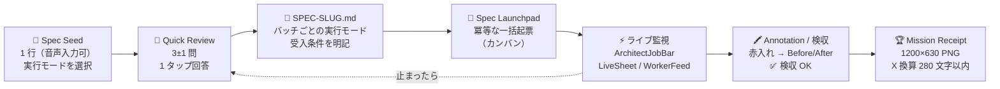

# Hermes Pilot — スマホから自律エージェントを操縦する意思決定コックピット

Hermes Pilot は、自律走行する [Hermes Agent](https://hermes-agent.nousresearch.com/docs) を **スマホ・タブレットから操縦する** ための PWA プラグインです。
エージェントが判断を仰ぐ場面を「1 タップのレビューシート」と「スクショへの赤入れ」に置き換え、**1 行の思いつきを、起票済みで自走するカンバンバッチまで運びます**（A2B パイプライン）。
カンバン・レビュー・チャット・メモ・ターミナル・設定の 6 タブを 1 つのインストール可能なアプリにまとめ、すべての操作を片手で完結させます。

**[▶ インタラクティブデモを試す](https://hajimemanila.github.io/hermes-pilot/)** — インストール不要・Hermes 不要。Spec Seed → Quick Review → Spec Launchpad → ライブ監視 → Mission Receipt の流れをモックで一通り触れます。

## 30 秒でわかる A2B パイプライン

1 行の意図が、ワーカーが最後まで走れる仕様書になります。質問をチャットに積み上げません。

- **A. SPEC 配置 → 1 タップ自律実装（基本ルート）** — `docs/SPEC-*.md` をリポジトリに置くだけで、Launchpad がバッチを拾い、1 タップ起票から実装が始まります。
- **B. Hermes Native で仕様策定（スマホ完結）** — Spec Seed → Quick Review → SPEC 生成 → Launchpad を PWA だけで回します。

どちらのルートも **外部 AI CLI を起動しません**。委譲は Hermes 自身のネイティブ委譲だけで、抽象ロール（`role:planner` / `role:builder` / `role:visual-reviewer` / `role:decision-framer`）で振り分けます。

## 画面プレビュー（Tasks タブ）

スマホ縦 `390×844` では 1 列、タブレット横 `1180×820` では Master-Detail の 2 ペインになります。同じ盤面を、同じ操作で。

| 📱 スマホ縦（`390×844`） | 🖥️ タブレット横 2 ペイン（`1180×820`） |
| :---: | :---: |
|  |  |

## 目次

### 🚀 ショーケース編 — 1 行のアイデアがプロダクトになるまで

題材 **FocusFlow**（ミニマル・ポモドーロ＆タスクタイマー）を、コピペできるプロンプト付きで 9 ステップ追体験します。

- [Showcase: From Idea to Product（SC01〜SC09 全 18 カット）](Showcase-From-Idea-to-Product.md) — 起点 → 設計面接 → 起票 → 自走監視 → 赤入れ → 比較検収 → 戦果レシート → アイデア拡張 → 品質維持

### 📖 マニュアル編（3 部作）

- [Manual: 導入と設定](Manual-Installation-and-Setup.md) — インストール 3 ルート、Bridge の常駐化、QR ペアリング、Settings の全体像、抽象ロール、PWA 診断、標準ダッシュボード連携
- [Manual: A2B タスクとレビュー](Manual-A2B-Tasks-and-Review.md) — ボード操作・タスク詳細と Git Diff・緊急停止・Review インボックス・Annotation ツールバー
- [Manual: チャット・メモ・ターミナル](Manual-Chat-Memos-and-Terminal.md) — ストリーミング、バブルメニュー、セッションドロワー、メモのハンドオフ、実 PTY、Theme × Vibe

## ドッグフーディング用クイックチェックリスト

自分の環境で 10 分だけ試すときの最短経路です（詳細な検査票は [`docs/WIKI-SHOTLIST.md`](../../WIKI-SHOTLIST.md)）。

- [ ] `npx hermes-pilot@0.3.0 init` → `start` でブリッジが `http://127.0.0.1:4097` で応答する
- [ ] スマホで QR を読み、`HttpOnly` セッション Cookie でログインできる（アドレスバーにトークンが残らない）
- [ ] Settings の **PWA 診断** が manifest / icons / Service Worker / scope で緑になる
- [ ] Tasks タブの `📝 Spec Seed` に 1 行を入れ、Quick Review の 3 問に 1 タップで答える
- [ ] Spec Launchpad から 1 タップ起票し、`ArchitectJobBar` と `WorkerFeed` に進捗が出る
- [ ] 赤入れ（Annotation）→ 修正 → `✅ 検収 OK` で 1 タップ完了し、完走レシートが出る

## 前提

- Node.js **22.19 以上**
- Hermes Agent（ブリッジは `http://127.0.0.1:9119` を中継します）
- 任意: [Tailscale](https://tailscale.com/)（外出先から HTTPS で使う場合）。同じ LAN なら `http://<lan-ip>:4097` で Tailscale 無しでも動きます

## このリポジトリの中身

| パス | 役割 |
| :--- | :--- |
| `apps/web/` | PWA 本体（React + Vite）。6 タブはすべて裏で状態を保持 |
| `apps/bridge/` | ブリッジ（:4097）。カンバン SQLite・Hermes WebSocket・プラグインデータを中継 |
| `apps/dashboard/` | 標準ダッシュボード（:9119）の `Hermes Pilot` タブ |
| `skills/` | 同梱スキル `quick-review` / `annotation` / `spec-architect` |
| `docs/wiki/` | このマニュアル＆ショーケース（`assets/<lang>/` にスクリーンショット） |

- 使い方の全体像: [`README.ja.md`](../../../README.ja.md)
- このウィキ自体の設計: [`docs/SPEC-WIKI-JA.md`](../../SPEC-WIKI-JA.md)
