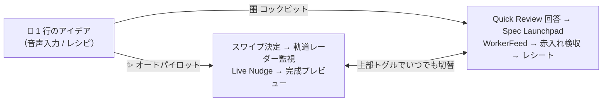
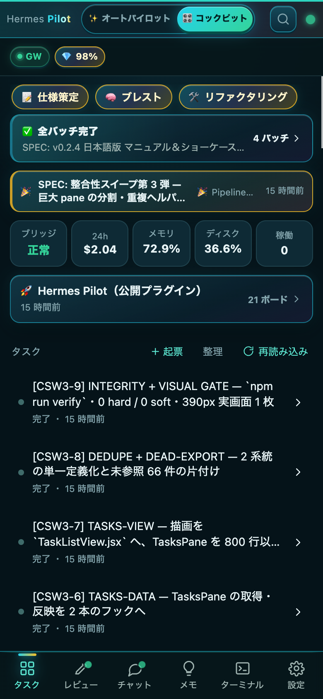
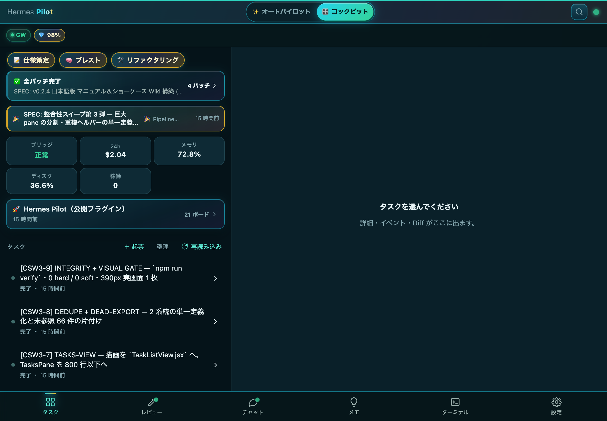

# Hermes Pilot — 自律エージェントをスマホから操縦する 2 モード・コックピット

Hermes Pilot（`v0.3.0`）は、自律走行する [Hermes Agent](https://hermes-agent.nousresearch.com/docs) を **スマートフォン・タブレットから直感的に操縦する** ための PWA プラグインです。
1 行の思いつきから設計インタビュー・実装・視覚検収・完了レシートまでをスマホ片手で完結させ、**用途に合わせて 2 つのモードをいつでも切り替えられます**。

- **✨ オートパイロットモード（`v0.3.0` 新搭載）** — スターターで 1 行入力 → ビジュアルカードのスワイプで設計決定 → 軌道レーダー＆X-Ray で進捗監視と割り込み指示 → 完成プレビューまでを 4 幕で自動進行。
- **🎛 コックピットモード（6 タブ統合）** — タスク（カンバン・Spec Launchpad・リファクタリング）／レビュー（一括承認・スクショ赤入れ）／チャット／メモ／ターミナル／設定の全機能をフルコントロール。

**[▶ インタラクティブデモを試す](https://hajimemanila.github.io/hermes-pilot/)** — インストール不要。オートパイロットのスワイプデッキ＆ライブレーダーも、コックピットの A2B パイプラインもブラウザ上で体験できます。

---

## 30 秒でわかる 2 つの進め方



- **Hermes Native 委譲のみで完結**: 外部 AI CLI の子プロセスを起動せず、Hermes 本体の委譲機能と抽象ロール（`role:planner` / `role:builder` / `role:visual-reviewer` / `role:decision-framer`）だけで安全に走ります。
- **そのままでも動く / 仕様書からでも動く**: 1 行の種から仕様策定を始めるルートと、既存リポジトリの `docs/SPEC-*.md` を Launchpad から 1 タップで起票するルートの両方に対応しています。

---

## 画面プレビュー（Tasks タブ）

スマホ縦 `390×844` では 1 列、タブレット横 `1180×820` では Master-Detail の 2 ペインになります。上部の **`✨ Autopilot ⇄ 🎛 Cockpit`** トグルはどちらの幅でも常に使えます。

| 📱 スマホ縦（`390×844`） | 🖥️ タブレット横 2 ペイン（`1180×820`） |
| :---: | :---: |
|  |  |

---

## 目次

### 🚀 ショーケース編（題材 FocusFlow を 2 通りの体験で紹介）

1. [ショーケース①: コックピット編（`SC01`〜`SC09` 全 18 カット）](Showcase-From-Idea-to-Product.md) — Spec Seed → Quick Review → Spec Launchpad → 自走監視 → 赤入れ → 比較検収 → 戦果レシート → アイデア拡張 → 品質維持
2. [ショーケース②: オートパイロット編（`AP01`〜`AP06` 全 12 カット）](Showcase-Autopilot-Mode.md) — スターター → Option-Cycle スワイプ＆スタイルガチャ → 軌道レーダー・X-Ray・Live Nudge → 完成＆成果物カード

### 📖 マニュアル編（3 部作）

- [Manual: 導入と設定](Manual-Installation-and-Setup.md) — インストール 3 ルート、常駐化、QR ペアリング、Settings の全体像、抽象ロール、PWA 診断、標準ダッシュボード連携
- [Manual: A2B タスクとレビュー](Manual-A2B-Tasks-and-Review.md) — モード切替導線、ボード操作、タスク詳細と Git Diff、リファクタリング、緊急停止、Review、Annotation ツールバー
- [Manual: チャット・メモ・ターミナル](Manual-Chat-Memos-and-Terminal.md) — ストリーミング、バブルメニュー、セッションドロワー、メモのハンドオフ、実 PTY、Theme × Vibe（ドーパミン演出）

---

## 3 分クイックスタート

1. **インストール＆起動**
   ```bash
   npx hermes-pilot@0.3.0 init
   npx hermes-pilot@0.3.0 start
   ```
2. **スマホでペアリング** — ターミナルに出た QR コードを読み取ると、`HttpOnly` セッション Cookie で安全にログインできます（アドレスバーにトークンを残しません）。
3. **まずは「✨ Autopilot」または「🎛 Cockpit」で 1 つ動かす** — 手軽に試すなら上部の **`✨ Autopilot`** へ切り替えて 1 行入力を、タスク一覧や仕様書の中身を細かく見たいときは **`🎛 Cockpit`** を使います。

---

## 動作環境

- Node.js **22.19 以上**
- Hermes Agent（ブリッジは既定で `http://127.0.0.1:9119` を中継します）
- 任意: [Tailscale](https://tailscale.com/)（外出先から HTTPS でアクセスする場合）。同じ LAN 内なら Tailscale 無しでも `http://<lan-ip>:4097` で利用できます。

## リポジトリ構成

| パス | 役割 |
| :--- | :--- |
| `apps/web/` | PWA 本体（React + Vite）。Autopilot / Cockpit 全画面を内蔵 |
| `apps/bridge/` | ブリッジ（:4097）。カンバン・Hermes WebSocket・プラグインデータを中継 |
| `apps/dashboard/` | 標準ダッシュボード（:9119）の `Hermes Pilot` タブ |
| `skills/` | 同梱スキル `quick-review` / `annotation` / `spec-architect` |
| `docs/wiki/` | 日本語マニュアル＆ショーケース |

- 全体の概要: [`README.ja.md`](../../../README.ja.md)
