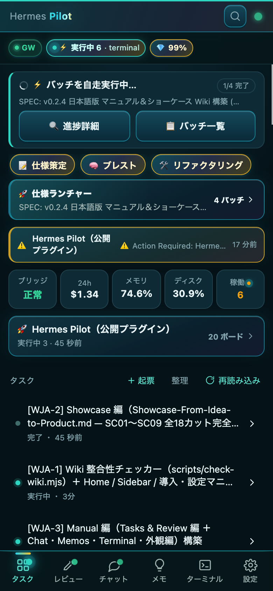
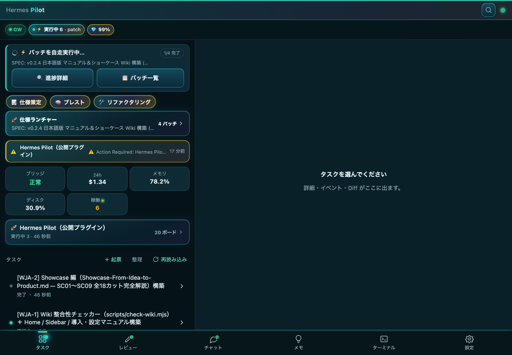
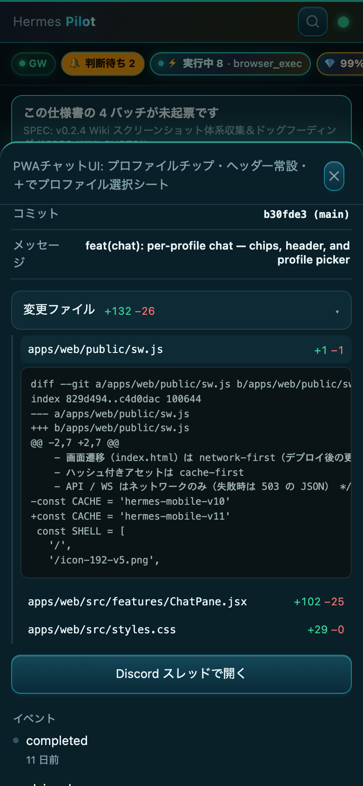
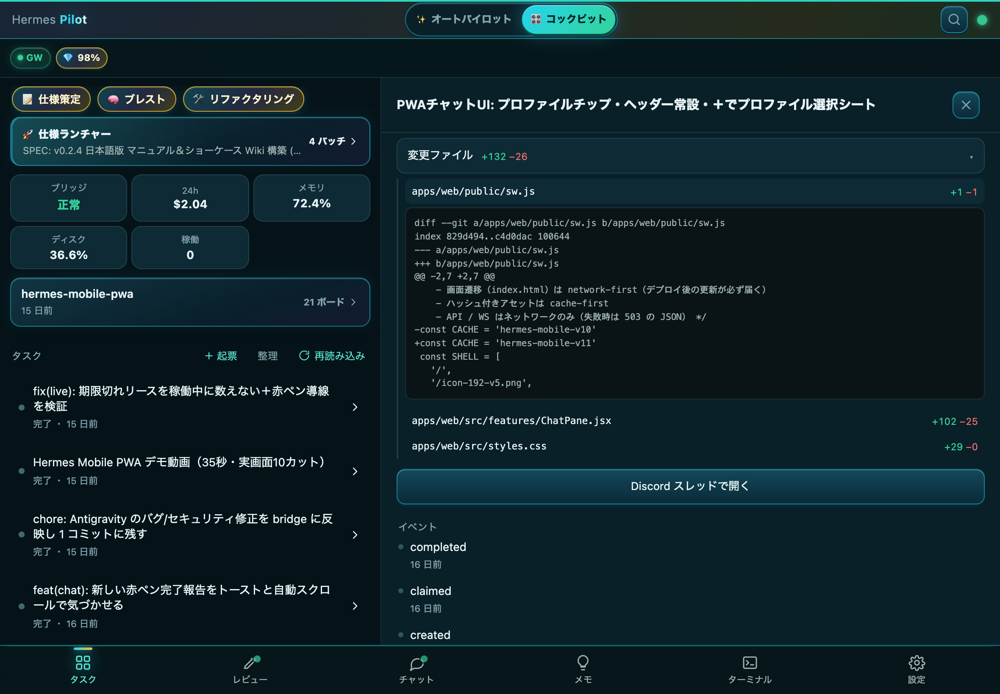
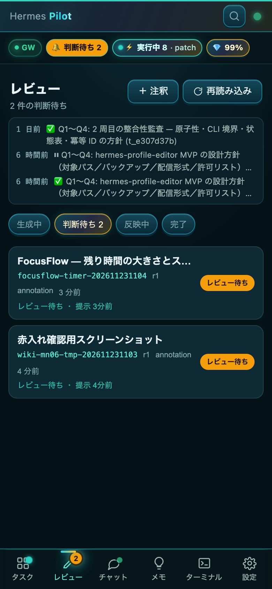
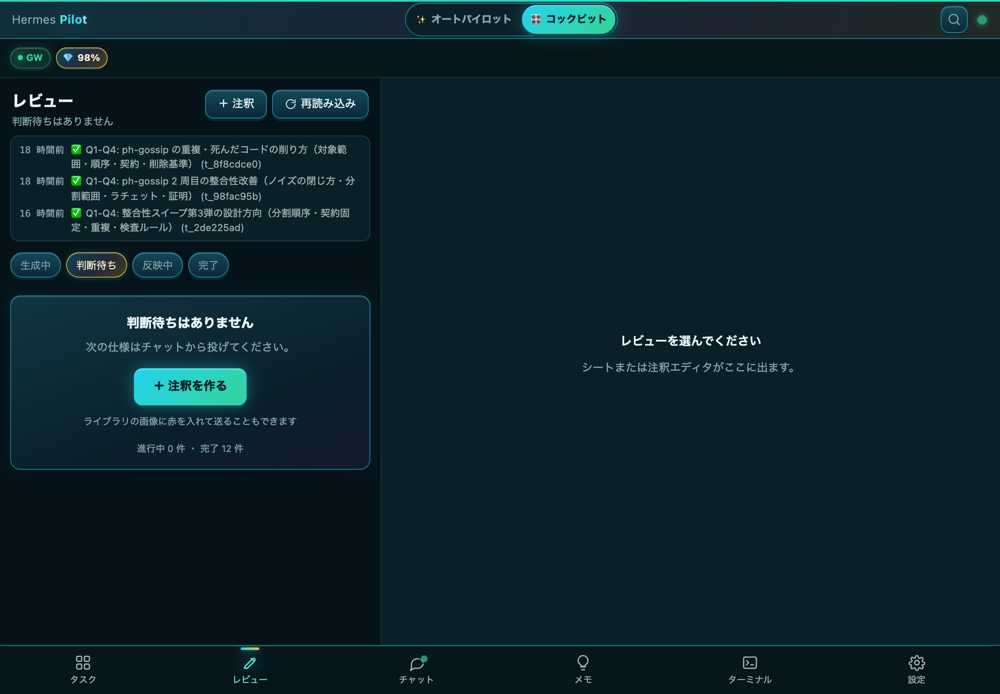
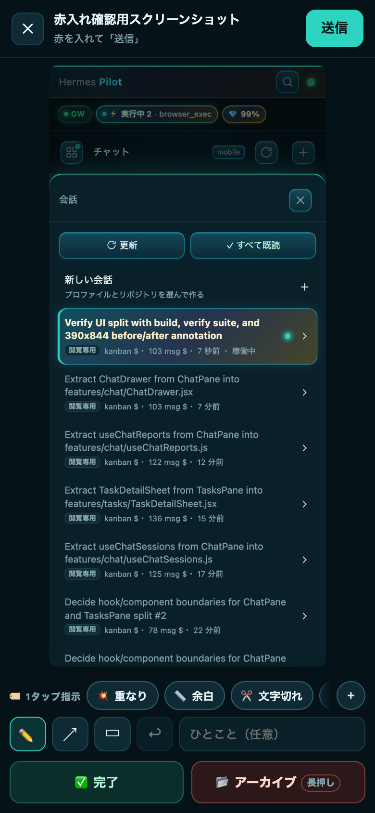
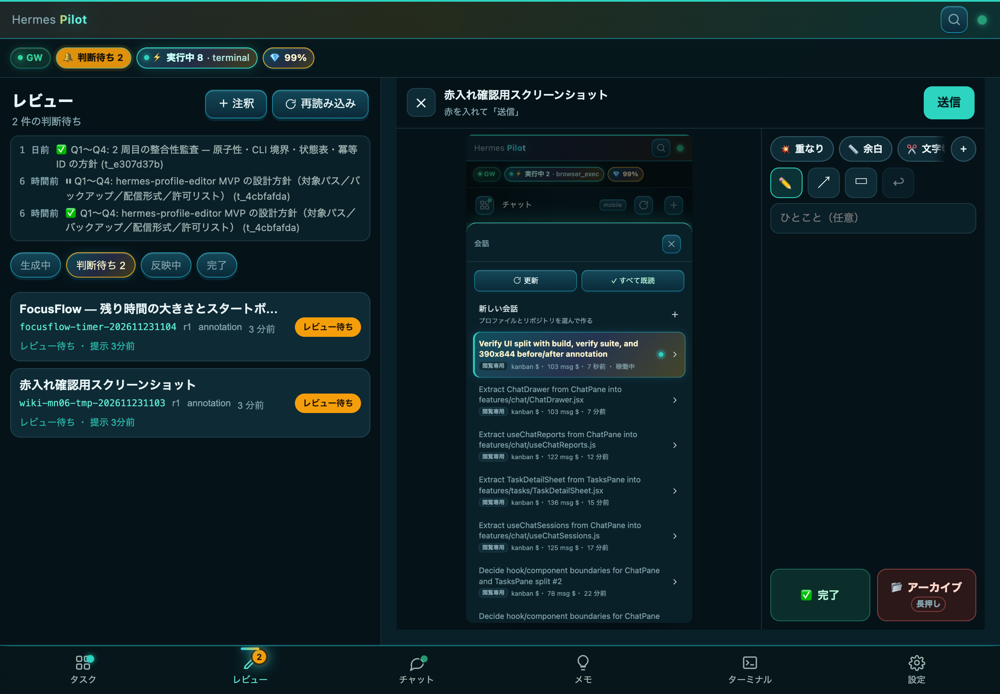

# マニュアル — Tasks & Review 編

[← Home](Home.md) ｜ [導入・設定編](Manual-Installation-and-Setup.md) ｜ [Showcase 編](Showcase-From-Idea-to-Product.md) ｜ [Chat・Memos・Terminal・外観編 →](Manual-Chat-Memos-and-Terminal.md)

このページは、**起票したタスクが「流れる」ところ**を扱います。作業を投げる（Tasks タブ）、
ワーカーの手を止めて人の判断を受ける（Review タブ）、届いたスクショに赤を入れて返す
（Annotation エディタ）、直ったかを確かめる（Before ↔ After 検収）までの 1 周が、
スマホ 1 台で閉じるように作られています。

扱う画面は `MN03`〜`MN06` の 8 カットです。すべて **左が 📱 スマホ縦 `390×844`、
右が 🖥️ タブレット横 2 ペイン `1180×820`** の並列比較で掲載しています。

- Tasks タブのボード切替・ステータスフィルタ・整理モード・3 つのアクションバー
- タスク詳細のイベント履歴・Git Diff・中断
- 全タスク緊急停止（ESTOP）
- Review インボックスの Waiting / Done・相対時刻フィード・1 タップ一括承認
- Annotation 赤入れエディタの描画ツールとスタンプ帯

> 画面の撮り方（同じ絵を自分で再現する手順）は [`docs/wiki/recipes/README.md`](../recipes/README.md)
> と [`docs/WIKI-SHOTLIST.md`](../../WIKI-SHOTLIST.md) にまとまっています。

---

## 0. 先に覚える 3 つの共通構造

1. **下部ナビは 6 タブ固定** — `タスク` / `レビュー` / `チャット` / `メモ` / `ターミナル` / `設定`。
   `レビュー` のタブには**判断待ちの件数バッジ**（オレンジの丸数字）が出ます。
   このバッジが 0 でない限り、あなたの判断を待ってワーカーが止まっています。
2. **画面上部に常設チップが並ぶ** — `GW`（Gateway の生死）、
   `実行中 N・<いま動いているツール名>`、`文脈 99%`（コンテキスト使用率）。
   **判断待ちがあるときだけ `判断待ち N` のチップが増えます**（0 件のときは出ません）。
   この並びはどのタブにいても同じ位置にあり、ここだけ見れば系全体の状態が分かります。
3. **`390` は 1 ペイン、`1180` は 2 ペイン** — タブレット幅では左に一覧、右に「選んだもの」が出ます。
   右ペインが空のときは「〜を選んでください」という案内が出ます。スマホ幅では
   一覧から選ぶと**全画面シート**が重なり、左上の `×` で戻ります。

---

## 1. Tasks タブ — ボード・フィルタ・3 つのアクションバー（`MN03`）

| 📱 スマホ縦 `390×844` | 🖥️ タブレット横 2 ペイン `1180×820` |
| :--- | :--- |
|  |  |

タブレット幅の絵が「Tasks タブのすべて」です。上から順に、**この順番で読む**ように作られています。

### 1-1. 仕様ランチャー（いちばん上）

`⚡ バッチを自走実行中… n/4 完了` の帯と、`SPEC: v0.2.4 …` の 1 行要約、そして
`進捗詳細` / `バッチ一覧` の 2 ボタン。ここは **`docs/SPEC-*.md` を起票したあとの「あと何バッチ残っているか」**
を常に見せる場所です。全バッチが終わると `全バッチ完了` に変わり、`バッチ履歴` から
どのバッチがいつ完了したかを後から辿れます。

### 1-2. 3 つのアクションバー

| ボタン | 何が起きるか | 使うタイミング |
| :--- | :--- | :--- |
| `📝 仕様策定` | 1 行の種（Spec Seed）を入力するシートが開く。実行ポリシーを `Visual-Gate`（赤入れ検収つき）か `Zero-Stop`（検証が通るまで自走）から選ぶ | まだ何もないアイデアを仕様にしたいとき |
| `🧠 ブレスト` | メモや 1 行の思いつきを、観点別に広げてチェックリストにするシートが開く | 方向性はあるが、やることが曖昧なとき |
| `🛠 リファクタリング` | コヒーレンス診断帯（Hard fails / Soft signals / Hotspots）と推奨スイープを出すシートが開く | 機能追加ではなく、品質を戻したいとき |

3 つとも**シートを開くだけでは何も起票されません**。中身を確認して最後のボタンを押したときに
初めてカンバンにタスクが生まれます。

### 1-3. 仕様ランチャー行・メトリクス・ボード行

- `仕様ランチャー … 4 バッチ >` — いま選んでいる SPEC のバッチ数。押すと起票シートが開きます。
- メトリクスの 5 枚 — `ブリッジ`（`正常` / `停止`）、`24h`（直近 24 時間のコスト）、
  `メモリ`、`ディスク`、`稼働`（同時に動いているエージェント数、`稼働 ● 8` のように出る）。
  ここが赤くなったときは、タスクを増やす前に系を疑ってください。
- `ボード行 … 20 ボード >` — **ボード切替はここ 1 か所**です。押すとボード一覧が開き、
  各行に `実行中 3・46 秒前`（最後の動き）が添えられます。`保管` はアーカイブ済みボード。

### 1-4. タスク一覧とフィルタ

見出し行は `タスク` ＋ `＋ 起票` / `整理` / `再読み込み` の 3 つ。

- `＋ 起票` — 空のタスクを 1 枚作る（タイトルと本文を後から書く）。
- `整理` — **整理モード**に入ります。ON の間はタスク行がチェックボックスに変わり、
  上部に `失敗・停止を全選択 (n)` / `選択を解除` / `選択を一括アーカイブ (n)` の操作帯が出ます。
  実行中のタスクは対象外で、**ファイルと履歴は残ります**（片付くのは盤面だけ）。
  1 枚ずつ長押しでアーカイブするより、この整理モードでまとめて処理するほうが速く、
  誤操作も起きません。終わったら `整理をやめる` で通常の一覧に戻します。
- `再読み込み` — 盤面を取り直す。ワーカーの完了が反映されないと感じたらまずこれを押します。

タスク行は `状態ドット + タイトル + メタ行` の 3 点セットです。
状態ドットの色がそのまま状態（実行中 / 停止 / 完了）を表し、右端に相対時刻
（`実行中・9分`、`完了・10 日前`、`完成・5 分前`）が出ます。**絶対時刻ではなく相対時刻**なので、
「さっき動いていたか」がひと目で分かります。

一覧の一番下には `アーカイブ済み (n)` のトグルがあり、閉じているあいだは
アーカイブ済みタスクが一覧に出ません（＝日常の視線に入らない）。

### 1-5. 操作手順（スマホで 1 周する）

1. `タスク` タブ → ボード行を押して対象ボードを選ぶ。
2. 目的に応じて `📝 仕様策定` / `🧠 ブレスト` / `🛠 リファクタリング` のどれかを押す。
3. シートの中身を確認して起票ボタンを押す（`N バッチを起票して自走開始` など）。
4. 一覧に戻ると、起票したタスクが状態ドット付きで並ぶ。行を押すと詳細（次章）。
5. 終わったものは `整理` でまとめて片付ける。

---

## 2. タスク詳細 — イベント履歴と Git Diff（`MN04`）

| 📱 スマホ縦 `390×844` | 🖥️ タブレット横 2 ペイン `1180×820` |
| :--- | :--- |
|  |  |

一覧の行を押すと、**「このタスクが何をしたか」だけ**が並ぶ詳細が開きます。
スマホ幅では一覧の上にシートとして重なり、タブレット幅では右ペインに居座ります。
どちらも中身は同じで、上から順に次の 6 ブロックです。

### 2-1. ヘッダ

タスクのタイトル（例: `PWAチャットUI: プロファイルチップ・ヘッダー常設…`）と、右端の `×`。
`×` は「詳細を閉じる」だけで、**タスクには何の影響もありません**。

### 2-2. コミット / メッセージ / 変更ファイル

- `コミット` — `b30fde3 (main)` のように短縮 SHA とブランチ。押すとそのコミットの詳細へ移ります。
- `メッセージ` — コミットメッセージ全文（`feat(chat): per-profile chat — chips, header, and profile picker`）。
- `変更ファイル` — `+132 −26` の合計。ここが `0` なら、そのタスクは**まだ何も書いていません**
  （ワーカーが調査だけして止まった、というサインになります）。

### 2-3. ファイルごとの Diff

変更ファイルは 1 ファイル 1 カードで並び、カードの右肩に `+1 −1` のような増減、
中に unified diff がそのまま入ります。`@@ -2,7 +2,7 @@` のハンクヘッダ付きなので、
「どこを触ったか」がそのまま読めます。表示は 100 ファイルまでで、超えると
`（100ファイルまで表示）` の注記が付きます。

### 2-4. `Discord スレッドで開く`

そのタスクの会話スレッドを Discord 側で開きます。スマホで「長い相談をしたい」ときは
PWA の入力欄より Discord のほうが楽なので、この導線が用意されています。

### 2-5. イベント履歴

`イベント` の見出しの下に、`completed` → `claimed` → `created` のように**新しい順**で
履歴が並び、それぞれに相対時刻（`11 日前`）が付きます。`blocked` が混ざっているタスクは、
「一度人の判断で止まった」タスクです。Review タブの該当シートを開くと理由が読めます。

### 2-6. 中断（Abort）

詳細の下にある `このタスクを中断` は、`reclaim → block` の 2 段で**再実行を止めます**。
「もう要らない」「方向が違う」と分かった時点で押してください。中断したあとにもう一度
同じ作業をしたい場合は、Review タブで `↩ 反映が不十分なとき（再確認を依頼）` を使うか、
新しいタスクとして起票し直します。

---

## 3. 全タスク緊急停止（`MN04` の詳細から開く）

「ワーカーが暴走している」「触ってほしくないリポジトリで動いている」というときのための
**1 か所だけの停止スイッチ**です。Tasks タブの `緊急操作` から
`緊急操作（長押しで実行）` シートを開くと、2 段に分かれています。

- `カンバン・タスク緊急停止`（カンバン・ワーカー）— 走っているタスクを止める側。
  シートの上には `全ボードで実行中 n 件です。` と、**止まる件数が先に出ます**。
- `Hermes Gateway 操作`（Bot / 通信）— Bot や通信そのものを止める側。

**長押しで実行**なのは誤タップで全部止めないためです。また停止の意味は 2 種類あり、
「新規作業のみ停止（実行中は完走する）」と「全タスク停止（ESTOP・実行中も一括中断）」は
別物です。どちらも解除は 1 タップ（安全方向に戻すのは速く）という設計です。

---

## 4. Review インボックス — 判断待ちを 1 タップで流す（`MN05`）

| 📱 スマホ縦 `390×844` | 🖥️ タブレット横 2 ペイン `1180×820` |
| :--- | :--- |
|  |  |

Review タブは **「あなたの判断待ち」だけを並べる受信箱**です。ワーカーは判断が必要になると
`needs_input` で止まり、ここにシート（または赤入れ待ちのスクショ）として現れます。
**あなたが答えるまで、そのタスクは 1 行も進みません。**

### 4-1. 画面の読み方

- 見出し `レビュー` の下に `n 件の判断待ち`。右上に `＋ 注釈`（新しい赤入れを作る）と
  `再読み込み`。
- その下の細い帯が**作業フィード**です。`1 日前 ✅ Q1〜Q4: 週目の整合性監査 — 原子性・CLI 境界…（t_e307d37b）`
  のように、**いつ・何を・どの回で答えたか**が 1 行ずつ積まれます。`✅` は回答済み、
  `↩` は差し戻し。時刻はすべて相対時刻で統一されているので、`3 分前` と `6 時間前` の
  区別がそのまま「今すぐ見るべきか」の判断材料になります。
- フィルタは 4 つ: `生成中` / `判断待ち n` / `反映中` / `完了`。
  **`生成中` はあなたの出番ではありません**（エージェントがシートを作っている最中）。
  `判断待ち` が実質の受信箱、`反映中` は回答を送ったあとワーカーが反映している状態です。
- カードは `タイトル / 元データ行 / レビュー待ち ピル / 提示 時刻`。
  元データ行には `<label>-NNNN r1 annotation 3 分前` のように
  **ラベル・回・種別・生成時刻**が入ります（`r1` = 第 1 回、`annotation` = 赤入れ待ち）。

### 4-2. 開いて答える

カードを選ぶと右ペイン（スマホはシート）に中身が開きます。中身は 2 種類です。

1. **アンケート型シート** — 3±1 問の選択肢。各問に `推奨` の印が付き、下に
   `未選択は推奨案で確定します。送信するとカンバンが ready に戻り、agent が反映します。`
   と書かれています。**推奨が付いていない問だけ**選べば済む、という設計です。
2. **赤入れ待ち（`annotation`）** — スクショが届いていて、Annotation エディタが開きます（次章）。

送信の最短ルートは `⚡ 推奨案（...）で一括承認して再開`。押すと全問に推奨案が入った状態で
一括送信され、タスクは `ready` に戻ってワーカーが自走を再開します。全件答え終わると
`🎉 All Clear — 全件の判断が完了し、ワーカーが自走中です` が出ます。

補足を書きたいときは各問の `補足（任意）`、全体に方針を伝えたいときは
`全体へのレビュー（任意）` に書きます。**回答が届くと Review タブからカードが消え、
Tasks タブの該当タスクが動き出します** — これが「止まっている／動いている」の合図です。

### 4-3. 反映があとから足りないと分かったとき

`完了` 列に残るカードには `↩ 反映が不十分なとき（再確認を依頼）` があります。
理由を書いて `review へ差し戻す` を押すと、そのタスクは **review に戻って再びワーカーの
作業対象になります**（新しく起票し直す必要はありません）。

---

## 5. Annotation 赤入れエディタ — スクショに赤を描いて返す（`MN06`）

| 📱 スマホ縦 `390×844` | 🖥️ タブレット横 2 ペイン `1180×820` |
| :--- | :--- |
|  |  |

言葉で説明するのが難しい修正は、**スクショに描いて返す**のが一番速い経路です。
`＋ 注釈` から下地（端末の画像 / ライブラリ）を選ぶと、このエディタが開きます。

### 5-1. 画面の構成

- ヘッダ: 対象名（例: `赤入れ確認用スクリーンショット`）と `赤を入れて「送信」` の案内、
  右端に `送信`。
- 中央: 赤入れ対象の画像（タップ・ドラッグで描く）。サイトのスクショでも、アプリの
  画面でも構いません。
- **スタンプ帯**: `⚙ タップ指示` / `★ 重なり` / `✓ 余白` / `✂ 文字切れ` / `＋`。
  よくある指摘を 1 タップで置けるプリセットです（`＋` で自作のスタンプを足す）。
  この帯は `設定 → 外観・操作 → 表示する帯` で消せます。
- **描画ツール**: 鉛筆（フリーハンド）・矢印・矩形・`元に戻す`。
- `ひとこと（任意）` — 描いた赤に一言添える欄。座標だけでは伝わらない意図をここに書きます。
- 下端: `✓ 完了` と `アーカイブ（長押し）`。**送信せずに閉じたい**ときは `✓ 完了` ではなく
  左上の `×`、用済みの下地は `アーカイブ` で片付けます（赤ペン待ちに残さない）。

### 5-2. 送信すると何が起きるか

送信されたものは、画像・赤のストローク・`ひとこと` の 3 点セットで
`annotation.json`（画像パス / 赤の領域を % で / ひとこと）に落ち、**同じタスクのコメント
経由でワーカーに戻ります**。ワーカーはそれを読み、patch を当て、次回のスクショを添えて
また Review に差し出します。つまりこの 1 枚が「指示書」になります。

### 5-3. うまくいかないとき

- `レビューを送れるのは「レビュー待ち」のシートだけです` — 完了済みのシートを開いています。
  もう一度直したいなら `↩ 反映が不十分なとき（再確認を依頼）` で review に戻してください。
- `画像を読み込めませんでした` — 下地の画像が消えています（チャット添付は数時間で消えます）。
  ライブラリに入れ直してから、新しい注釈として作り直します。
- 送信が通らない — 端末の画像は長辺 1600px / JPEG 0.85 に縮小して送る仕様です。
  極端に大きい画像は先に縮小してください。

---

## 6. 1 周の通し方（Before ↔ After 検収まで）

1. Tasks タブで起票する（`MN03`）。
2. ワーカーが判断待ちで止まる → Review タブの `判断待ち` に現れる（`MN05`）。
3. アンケートなら `⚡ 推奨案で一括承認`、見た目なら `＋ 注釈` で赤を描いて `送信`（`MN06`）。
4. `反映中` → `完了` に移り、Tasks タブのタスクが再び動く。
5. 直りが足りなければ `↩ 反映が不十分なとき` で差し戻す。十分ならそのまま完了。
6. 終わったタスクは Tasks タブの `整理` でまとめて片付ける。

---

## 7. できたことの確認（チェックリスト）

- [ ] `レビュー` タブのバッジが 0 のとき、Tasks タブの状態ドットがどれも「実行中」か「完了」になっている
- [ ] タスク詳細で `変更ファイル` が `0` のタスクを見つけたら、イベント履歴に `blocked` が無いか確認した
- [ ] `緊急操作` シートを開いて、**押さずに** `×` で閉じられた（長押し設計を理解した）
- [ ] Review のカードで `⚡ 推奨案で一括承認` を 1 度押し、`🎉 All Clear` を見た
- [ ] Annotation エディタで矩形と矢印を描き、`ひとこと` を添えて送信した
- [ ] 完了済みシートで `↩ 反映が不十分なとき` の存在を確認した（押す必要はない）

---

## 8. 次に読む

- [Chat・Memos・Terminal・外観編 →](Manual-Chat-Memos-and-Terminal.md) — 相談・メモ・実端末・見た目の設定
- [Showcase 編](Showcase-From-Idea-to-Product.md) — この 4 画面が 1 本のストーリーとして繋がる実例
- [導入・設定編](Manual-Installation-and-Setup.md) — ペアリング、抽象ロール、PWA 診断
- [Home に戻る](Home.md)
