# マニュアル — Chat・Memos・Terminal・外観編

[← Home](Home.md) ｜ [導入・設定編](Manual-Installation-and-Setup.md) ｜ [Showcase 編](Showcase-From-Idea-to-Product.md) ｜ [← Tasks & Review 編](Manual-A2B-Tasks-and-Review.md)

タスクを流すのが Tasks / Review なら、こちらは**日常づかいの 4 タブ**です。
エージェントと相談する `チャット`、思いつきを溜めて種に変える `メモ`、
手を動かす `ターミナル`、そして見た目と手ざわりを決める `設定 → 外観・操作`。

扱う画面は `MN07`〜`MN13` の 14 カットです。すべて **左が 📱 スマホ縦 `390×844`、
右が 🖥️ タブレット横 2 ペイン `1180×820`** の並列比較で掲載しています。

- Chat タブのストリーミング応答・ツールログ・プロファイル選択・定型チップ
- メッセージのバブル操作メニュー（コピー / メモ / 3 点要約 / 深掘り / 引用）
- セッション一覧ドロワー（`継続可` / `閲覧専用` バッジ、稼働中ドット、横断の並び）
- Memos の表示モード切替（1 列 / 2 列 / リスト）と完了レポート受信箱
- メモから `🧠 ブレスト` / `📝 仕様策定` への 1 タップ引き継ぎ
- Terminal の実 PTY・OS 連動の定型コマンド・IME 中でも効く Enter
- Theme（ダーク / ライト / 端末に合わせる）× Vibe（ドーパミン / セロトニン）

> 同じ絵を自分で再現する手順は [`docs/wiki/recipes/README.md`](../recipes/README.md) に、
> カット一覧は [`docs/WIKI-SHOTLIST.md`](../../WIKI-SHOTLIST.md) にあります。

---

## 1. Chat タブ — 相談はここから始まる（`MN07`）

| 📱 スマホ縦 `390×844` | 🖥️ タブレット横 2 ペイン `1180×820` |
| :--- | :--- |
| 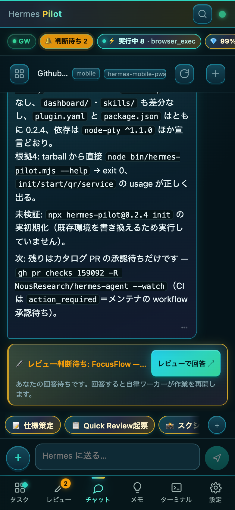 | 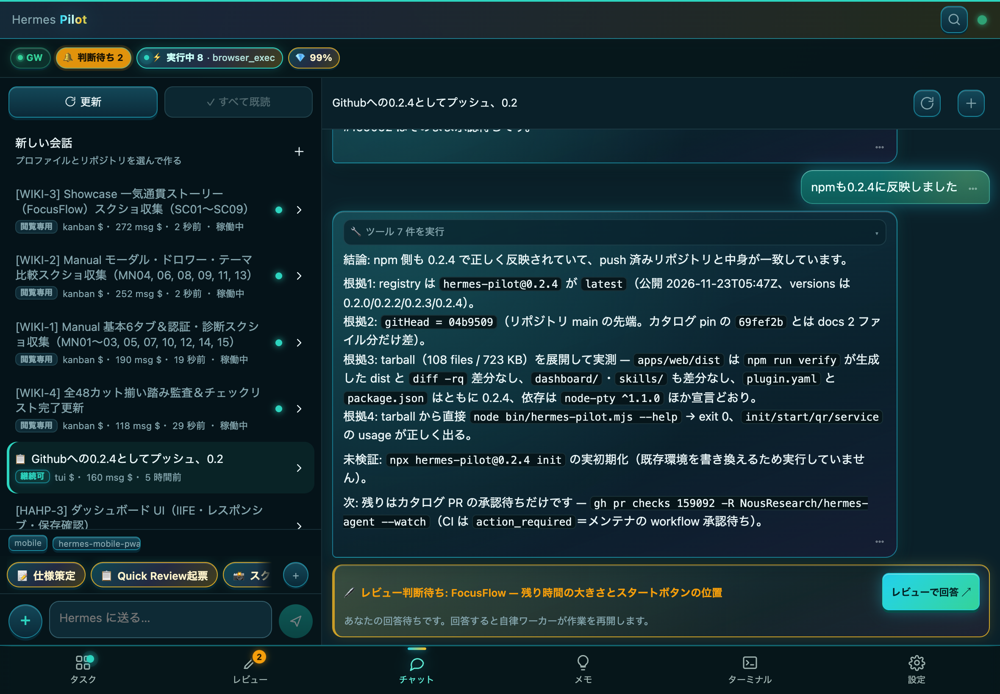 |

### 1-1. ヘッダのチップは「この会話の前提」

ヘッダには `Github..`（会話名の短縮）、`mobile`（プロファイル）、`hermes-mobile-pwa`（リポジトリ）が
チップで並び、右に再読み込みと `＋`（新しい会話）。**どのプロファイル・どのリポジトリの会話か**が
常に見えているので、「別リポジトリの話をしているつもりで違う repo を触らせた」という事故が起きません。
タブレット幅では同じ情報が左ペインの一覧側に出て、右ペインが最小ヘッダのタイムラインになります。

### 1-2. タイムラインの 3 種のブロック

1. **メッセージバブル** — ユーザーは右寄せの枠線バブル、エージェントは左のカード。
   長い回答は縦に伸び、末尾の `…` から操作メニューが開きます（次章）。
2. **ツール実行ログ** — `🔧 ツール 7 件を実行` の 1 行に畳まれています。押すと開いて、
   どのツールを何回使ったかが読めます。ストリーミング中はヘッダが `思考・ツール実行中` に変わります。
   畳んであるのは、**回答本文を読みたいときにログが邪魔をしない**ようにするためです。
3. **レビュー判断待ちバナー** — `✓ レビュー判断待ち: <タスク名>` と `レビューで回答 ↗`。
   チャットで相談した内容が判断待ちになると、この帯が出ます。押すと Review タブの該当シートへ
   直接飛ぶので、「どこで止まっているか」を探さずに済みます。

### 1-3. 定型チップと入力欄

入力欄の上に `📝 仕様策定` / `📘 Quick Review起票` / `🔍 スク…` のようなチップ帯。
**タップで入力欄に挿入（送信はしない）／長押しで即送信**という 2 段の作法です。
誤爆を避けたい長文はタップ→確認してから送る、定型の短い指示は長押しで一気に送る、と使い分けます。
`＋` からは添付と定型文（スニペット）の一覧を開けます。自作のスニペットは設定タブで追加できます。

入力欄は `Hermes に送る…`、右端が送信。ストリーミング中でも入力は可能で、
届いた応答は上から順に伸びていきます。

---

## 2. メッセージの操作メニュー（`MN08`）

| 📱 スマホ縦 `390×844` | 🖥️ タブレット横 2 ペイン `1180×820` |
| :--- | :--- |
| 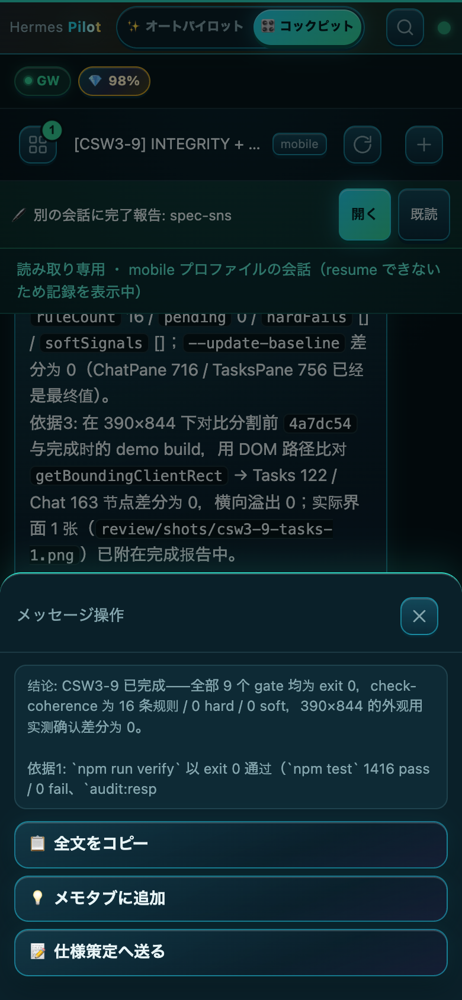 | 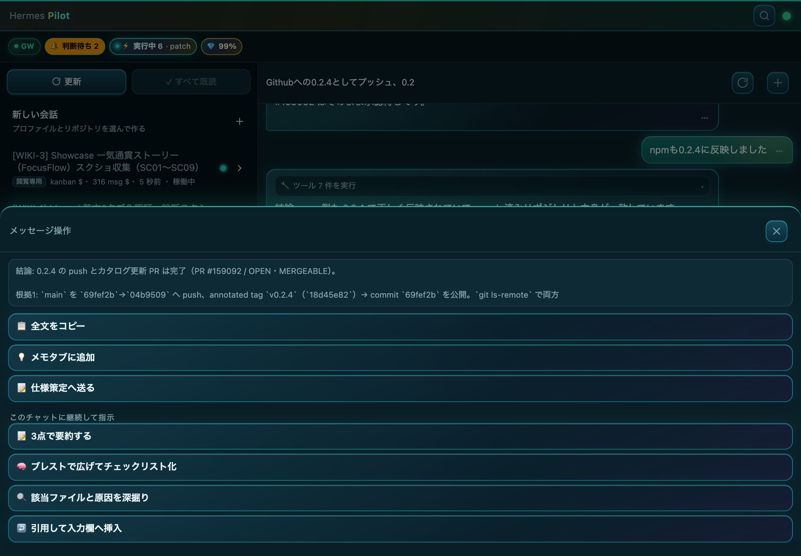 |

バブルの `…` を押すと、下から `メッセージ操作` シートが出ます。**ボトムシートなので
画面外にはみ出しません**（スマホ幅でも全項目が指の届く位置に並びます）。

### 2-1. その場で済む 3 つ

- `📋 全文をコピー` — バブルの本文を丸ごとクリップボードへ。
- `💡 メモタブに追加` — 気づきを**そのままメモ化**。あとで `ブレスト` の種になります。
- `📝 仕様策定へ送る` — 本文を Spec Seed シートに引き継ぐ（＝次のタスクの起点にする）。

### 2-2. `このチャットに継続して指示` の 4 つ

- `📝 3点で要約する` — 長い回答を 3 点に畳ませる。
- `🧠 ブレストで広げてチェックリスト化` — アイデアを実行可能な項目に分解させる。
- `🔍 該当ファイルと原因を深掘り` — その話題のファイル・シンボル・原因まで掘らせる。
- `↩️ 引用して入力欄へ挿入` — 引用ブロックとして入力欄に入れる（自分の言葉を足して送る）。

どれも**メニューを閉じたあと、入力欄にプロンプトが入る（または即送信される）**だけで、
会話の文脈は保たれたままです。4 つとも「同じ質問を書き直さなくてよい」ための近道です。

---

## 3. 会話の切替（`MN09`）

| 📱 スマホ縦 `390×844` | 🖥️ タブレット横 2 ペイン `1180×820` |
| :--- | :--- |
| 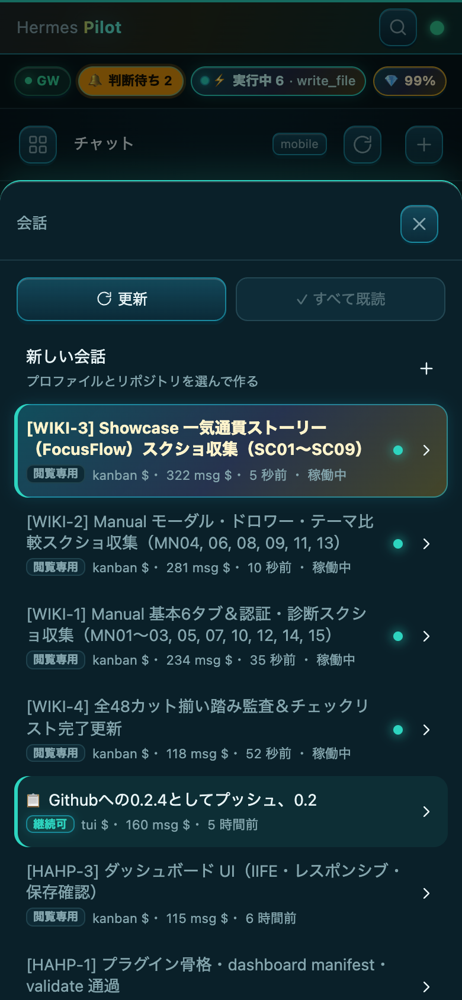 | 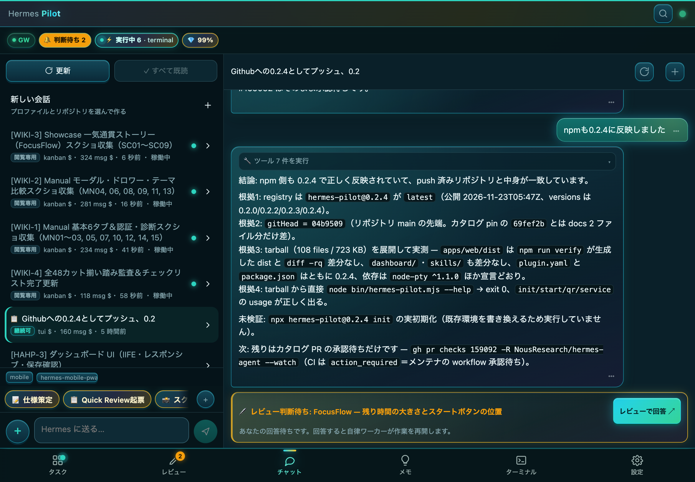 |

スマホ幅ではヘッダ左の一覧アイコンから `会話` ドロワーが開き、タブレット幅では
同じ一覧が左ペインに常設されます。

### 3-1. 一覧の読み方

- 上に `更新` と `すべて既読`。`すべて既読` は未読の完了報告をまとめて既読にします。
- `新しい会話` — `プロファイルとリポジトリを選んで作る` と添えられ、右の `＋` から開始。
- 各行は **タイトル / メタ行 / 右端の `›`**。メタ行は
  `閲覧専用 kanban・322 msg・5 秒前・稼働中` あるいは `継続可 tui・160 msg・5 時間前` の形です。

| メタの要素 | 意味 |
| :--- | :--- |
| `継続可` | そのまま会話を続けられるセッション |
| `閲覧専用` | 読むだけ（実行中の worker など、こちらから発言できないセッション） |
| `kanban` / `tui` | 会話の出どころ（カンバンのワーカー / 端末の TUI） |
| `322 msg` | そのセッションのメッセージ数（重さの目安） |
| `5 秒前` / `5 時間前` | 最後の動き（相対時刻） |
| `稼働中` + 緑ドット | いま動いている |

**緑のドットがついている行は、開くと進行中の出力がそのまま流れてきます**。
`閲覧専用` の行を開いても壊れません（読むだけ）。「動いているもの」と「続けられるもの」を
同じ一覧で見分けられるのが、このドロワーの役割です。

---

## 4. Memos — 思いつきを溜めて種にする（`MN10`）

| 📱 スマホ縦 `390×844` | 🖥️ タブレット横 2 ペイン `1180×820` |
| :--- | :--- |
| 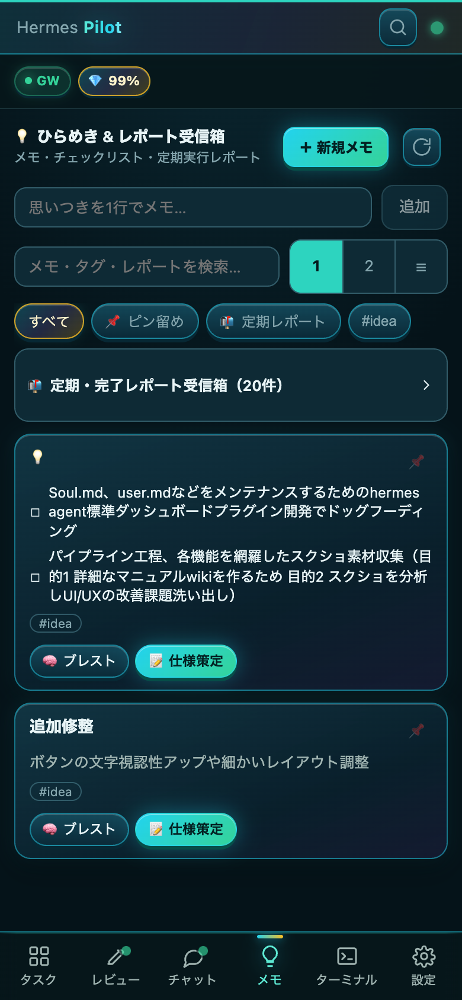 | 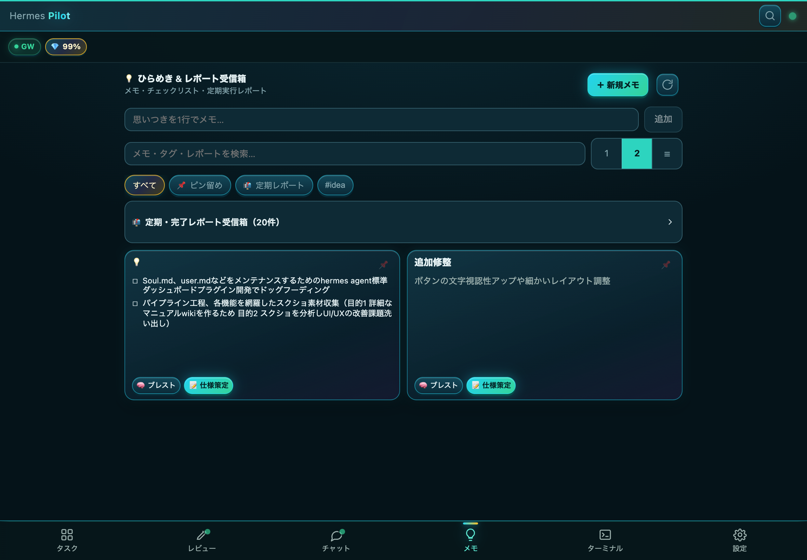 |

### 4-1. 画面の構成

- 見出し `📌 ひらめき＆レポート受信箱` と副題 `メモ・チェックリスト・定期実行レポート`、
  右上に `＋ 新規メモ` と再読み込み。
- 1 行入力 `思いつきを1行でメモ…` ＋ `追加` — **思いついた瞬間に 1 行だけ放り込む**ための欄。
  整形もタグ付けも要りません。
- 検索欄 `メモ・タグ・レポートを検索…`、右にページ送り（`1` `2`）とリスト表示の切替（`≡`）。
- フィルタチップ `すべて` / `📌 ピン留め` / `📅 定期レポート` / `#idea`。
  タグは自由に増やせて、`#idea` のようにそのままチップになります。
- `📅 定期・完了レポート受信箱（20件）` — **ワーカーの完了報告がここに溜まります**。
  定期実行（cron）の結果も同じ場所なので、「昨日の夜の実行どうだった？」はこの 1 行を開けば済みます。

### 4-2. 列の切り替え（`1` / `2` / `≡`）

検索欄の右にある `1` / `2` / `≡` が表示モードの切替です。**列の数は画面幅ではなく
この切替で決まり**、選んだモードは端末ごとに保存されます。

| モード | 見た目 | 何に向くか |
| :--- | :--- | :--- |
| `1`（1 列） | カードが横幅いっぱい。高さは内容に応じて伸びる。タグも出典行も見える | 長いメモを読む、スマホで 1 枚ずつ |
| `2`（2 列・既定） | 2 列固定。カードは高さ 220px・本文 4 行でクランプ。**出典行とタグは省く** | 一覧して比べる、タブレット横 |
| `≡`（リスト） | 1 行 1 メモの細い行 | 大量のメモをスクロールで拾う |

掲載カットは `390` が 1 列（`1` 選択）、`1180` が 2 列（`2` 選択）です。2 列にすると 1 枚あたりの情報は落ちますが、
**行の下端が揃う**ので一覧性が上がります（なお `430px` 以下のスマホ縦幅では、`2` が選ばれていてもカード幅が潰れないよう自動で 1 列表示へフォールバックします）。

### 4-3. カード 1 枚の中身

📌（ピン留め）と右上の `↖`（送る）、本文、タグ、そして下端に `🧠 ブレスト` と `📝 仕様策定`。
チェックリスト形式のメモは項目がそのまま並びます。ピン留めしたメモは `📌 ピン留め` で
絞り込めるので、**常に見返したい 3 枚**だけを残しておく使い方ができます。

---

## 5. メモから次の作業へ 1 タップで渡す（`MN11`）

| 📱 スマホ縦 `390×844` | 🖥️ タブレット横 2 ペイン `1180×820` |
| :--- | :--- |
| 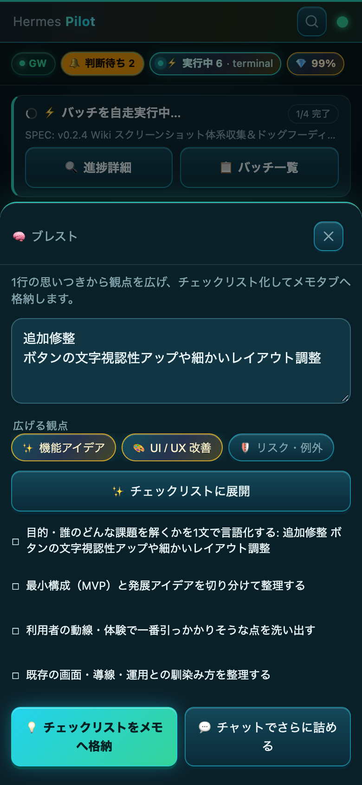 | 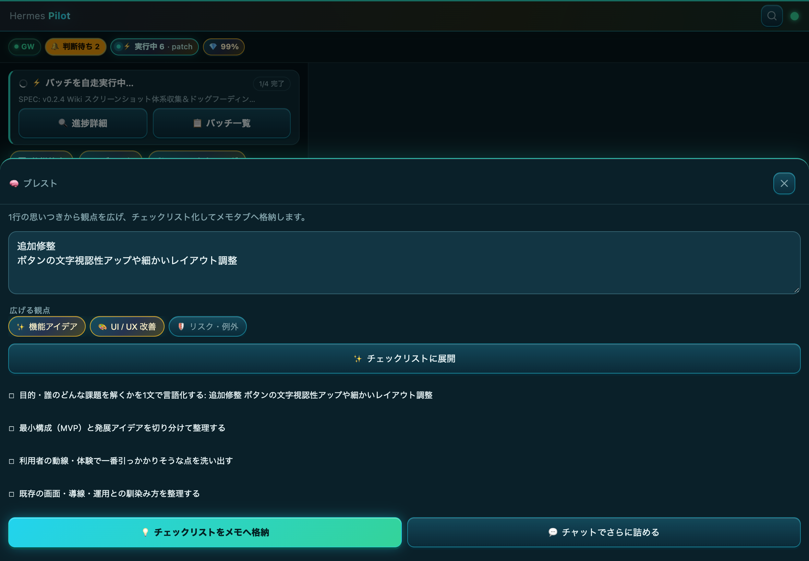 |

カードの `🧠 ブレスト` を押すと、本文が引き継がれた `ブレスト` シートが開きます。
上部の説明は `1行の思いつきから観点を広げ、チェックリスト化してメモタブへ格納します。`。

1. 本文欄にはメモの内容がそのまま入っている（例: `追加修理 / ボタンの文字視認性アップや細かいレイアウト調整`）。
   ここで書き足してもよい。
2. 観点チップ `⚡ 機能アイデア` / `🎨 UI/UX 改善` / `⚠ リスク・例外` で、**どう広げるか**を選ぶ。
3. `✨ チェックリストに展開` を押すと、目的・最小構成（MVP）・利用者の動線・既存の画面や運用との
   馴染み方、の観点でチェック項目が並ぶ。
4. 出口は 2 つ。`💡 チェックリストをメモへ格納`（メモとして戻す）か
   `💬 チャットでさらに詰める`（そのまま会話で具体化する）。

`📝 仕様策定` を押した場合は、本文が **Spec Seed シート**に引き継がれます。
つまりメモは「読み返すノート」ではなく、**そのまま次のタスクの入力**になります。

> コツ: チェックリストだけのメモは本文が空なので、引き継ぐ文面がありません。
> ブレストに渡したいメモには、必ず 1 行でも本文を書いておいてください（実測で確認済み）。

---

## 6. Terminal — 実 PTY をポケットから（`MN12`）

| 📱 スマホ縦 `390×844` | 🖥️ タブレット横 2 ペイン `1180×820` |
| :--- | :--- |
| 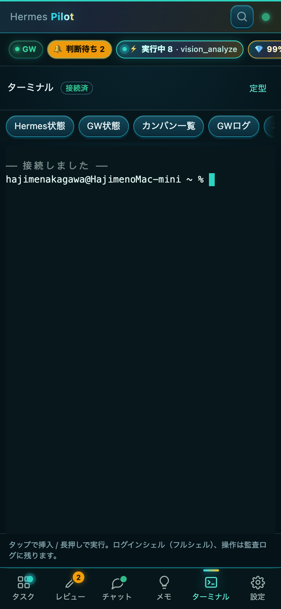 | 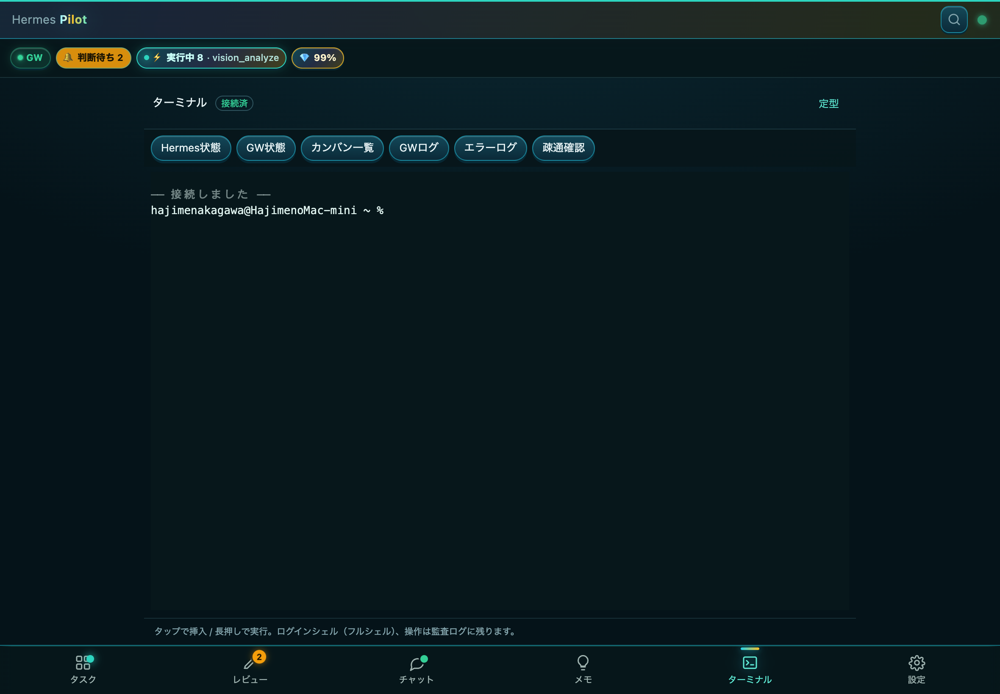 |

### 6-1. 見えているもの

- 見出し `ターミナル` と接続状態のピル（`接続中` / `接続済` / `切断` / `再接続中` / `エラー`）。
- 右に `定型` — 定型コマンドの一覧を開くボタン。
- その下が **本物の端末**です。`── 接続しました ──` のあとに
  `hajimenakagawa@HajimenoMac-mini ~ %` のようなログインシェルのプロンプトが出ます。
  モックではなく PTY（疑似端末）にそのまま繋がっており、`ls` も `git status` も対話コマンドも動きます。

### 6-2. 定型コマンド（OS 連動）

`Hermes状態` / `GW状態` / `カンバン一覧` / `GWログ` のようなチップが並びます。
作法はチャットの定型チップと同じ 2 段です。

- **タップ** → 入力欄に挿入（Enter は送らない）。引数を足してから送れる。
- **長押し**（または右の `実行`）→ Enter まで送って実行する。

`再起動系はターミナル（ai.hermes.hermes-mobile）と別プロセスなので、この画面は切れません` —
つまり Gateway を再起動しても、この端末画面自体は生き残ります。詰まったときの最後の手段として
ここから直せます。既定の定型に**削除・kill のような破壊的コマンドは載っていません**
（再起動・復旧系は `定型` のシート側に分けてあり、常駐バーには安全な読み取り専用だけが並びます）。

### 6-3. Enter が効くということ

スマホの端末でいちばん壊れやすいのが Enter です。別タブから戻ったときに隠し `textarea` のフォーカスが外れたり、日本語 IME が ON（変換中）のまま確定 Enter を押して PTY へ `\r` が届かなくなる現象が起きがちです。
このアプリは **タブ復帰時に `xterm` へ自動で再フォーカスし、さらに `.term-host` のキャプチャ段で IME 変換中（`isComposing`）であっても Enter 1 回で常に `\r` を PTY へ送る** ため、日本語キーボードのままでも Enter が死なずに即実行できます。送信は WebSocket の 1 フレームとして渡り、二重送信も起きません。

---

## 7. 見た目と手ざわり — Theme × Vibe（`MN13`）

| 📱 スマホ縦 `390×844` | 🖥️ タブレット横 2 ペイン `1180×820` |
| :--- | :--- |
| 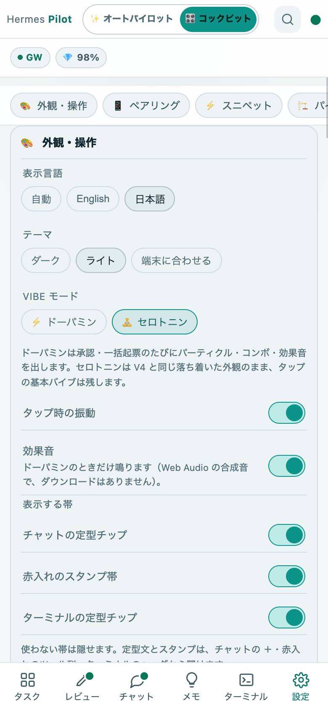 | 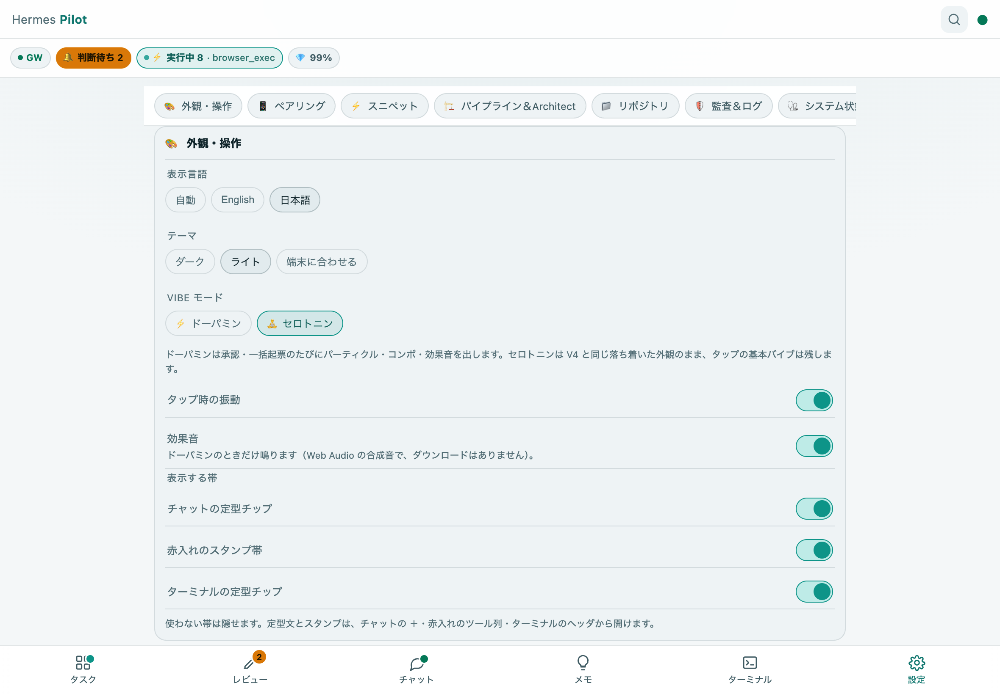 |

`設定 → 外観・操作` に、見た目の決定が 1 か所にまとまっています。
掲載カットは **ライト × セロトニン**の組み合わせです。

### 7-1. 決めるのは 3 つ

1. `表示言語` — `自動` / `English` / `日本語`。`自動` は端末の言語に従います。
2. `テーマ` — `ダーク` / `ライト` / `端末に合わせる`。`端末に合わせる` は OS の
   ダークモード設定に追従するので、朝夕で切り替わる端末と相性が良い設定です。
3. `VIBE モード` — `⚡ ドーパミン` / `🧘 セロトニン`。

| Vibe | 何が変わるか |
| :--- | :--- |
| `⚡ ドーパミン` | 承認・一括起票のたびにパーティクル・コンボ・効果音が出る。進んでいる実感が欲しいとき |
| `🧘 セロトニン` | 落ち着いた外観のまま。**タップの基本バイブは残る**ので、操作の手応えは失わない |

### 7-2. 独立して残る 3 つのスイッチ

- `タップ時の振動` — Haptics。Vibe とは独立で、切れば完全に静かになります。
- `効果音` — ドーパミンのときだけ鳴ります（Web Audio の合成音で、ダウンロードはありません）。
- `表示する帯` — `チャットの定型チップ` / `赤入れのスタンプ帯` / `ターミナルの定型チップ` を
  個別に ON/OFF。使わない帯は隠せます。隠しても、チャットの `＋`・赤入れのツール列・
  ターミナルのヘッダから開けます（＝機能は消えず、場所が変わるだけ）。

**Theme と Vibe は直交**しています。`ダーク × ドーパミン` でも `ライト × セロトニン` でも、
レイアウト・文字サイズ・操作はまったく同じで、色・動き・音だけが入れ替わります。
切り替えたときに見るべきは 1 点だけ — **バッジや枠線に黒い縁が漏れていないか**（P7 の既知観点）。

---

## 8. 組み合わせ早見

| 場面 | おすすめ | 理由 |
| :--- | :--- | :--- |
| 夜、布団の中で判断だけ済ませる | `ダーク` × `セロトニン`、`効果音 OFF` | 光と音を抑えつつ、バイブで操作は分かる |
| 日中、作業を流したい | `端末に合わせる` × `ドーパミン` | 一括承認の手応えが進捗の実感になる |
| 人前・会議中 | `ライト` × `セロトニン`、`振動 OFF` | 画面も音も目立たない |
| 片手で長文を打つ | 帯は `チャットの定型チップ` だけ ON | 入力欄の上が広く使える |

---

## 9. うまくいかないとき

- **チャットの応答が来ない** — 上部の `GW` チップが `停止` になっていないか。`実行中` の
  チップに何も出ていなければ、送信自体が届いていません（`再読み込み` を 1 回）。
- **会話一覧に目的のセッションが無い** — `閲覧専用` のものは一覧の下のほうに沈みます。
  検索は一覧のタイトル・メタ行が対象です。新しく始めるなら `新しい会話` → プロファイルと repo を選ぶ。
- **メモからブレストに文面が渡らない** — そのメモの本文が空です（チェックリストだけのメモ）。
  1 行足してから開き直してください。
- **ターミナルが `再接続中` のまま** — 数十秒待つと自動で戻ります。戻らない場合は、別の
  ターミナル（PC 側）から Gateway の状態を見てください。この画面は再起動系の影響を受けません。
- **Enter が効かない** — 端末の画面（黒い領域）を 1 回タップしてフォーカスを当ててから Enter を押してください（タブ切替時は自動で再フォーカスされ、IME 変換中でも Enter 1 回で即 `\r` が送られます）。
- **見た目が半分だけ変わる** — `テーマ` と `VIBE モード` は別物です。片方だけ変えた状態が正常です。

---

## 10. できたことの確認（チェックリスト）

- [ ] チャットで 1 往復し、`🔧 ツール n 件を実行` を開いて中身を読んだ
- [ ] バブルの `…` から `💡 メモタブに追加` を実行し、メモタブに出たことを確認した
- [ ] 会話ドロワーで `継続可` と `閲覧専用` の違いを目で見分けられた
- [ ] メモを 1 行追加し、`🧠 ブレスト` → `✨ チェックリストに展開` → メモへ格納まで通した
- [ ] ターミナルで `pwd` を打って実行し、`定型` チップを長押し実行した
- [ ] `ダーク ⇄ ライト` を切り替え、バッジ・枠線に黒縁の漏れが無いことを確認した
- [ ] `ドーパミン` と `セロトニン` を切り替え、`タップ時の振動` が独立して残ることを確認した

---

## 11. 次に読む

- [Tasks & Review 編](Manual-A2B-Tasks-and-Review.md) — 起票・判断待ち・赤入れ・検収
- [Showcase 編](Showcase-From-Idea-to-Product.md) — メモから 1 本のプロダクトができるまで
- [導入・設定編](Manual-Installation-and-Setup.md) — ペアリング、抽象ロール、PWA 診断
- [Home に戻る](Home.md)
