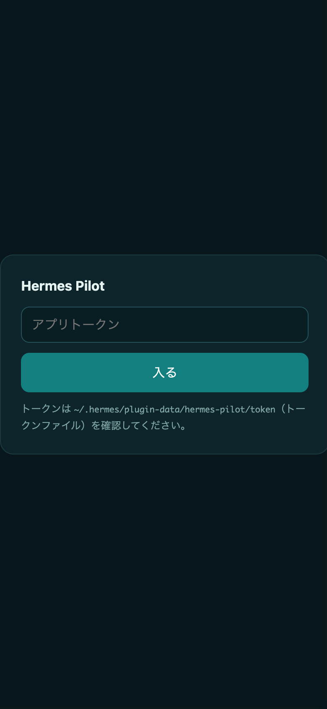
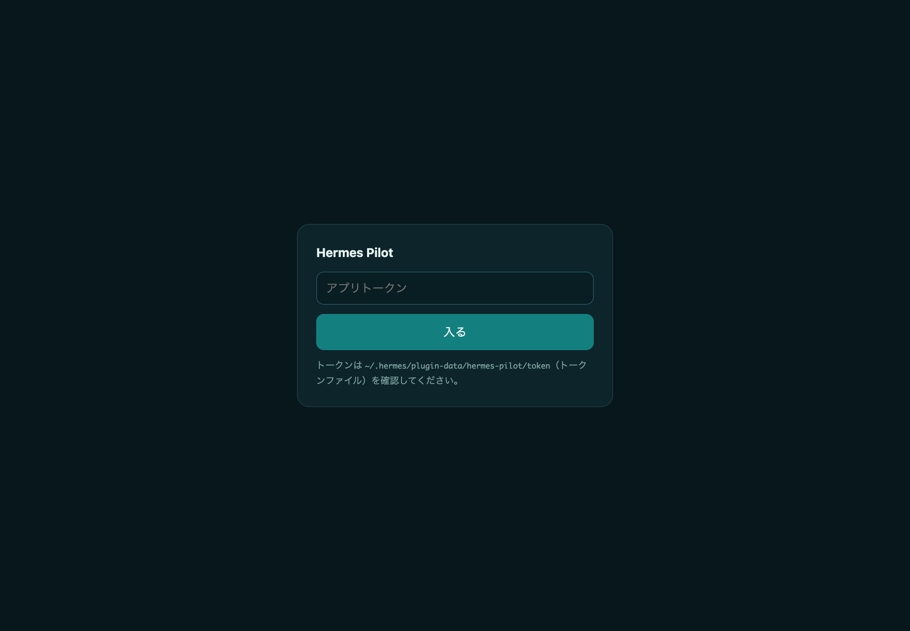
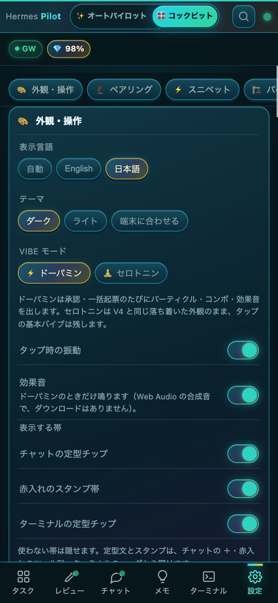
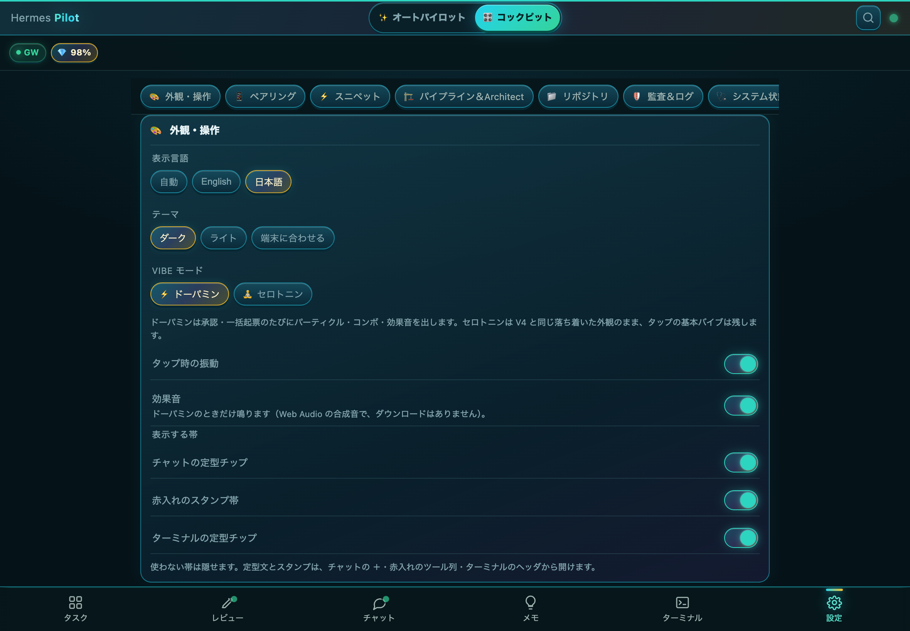
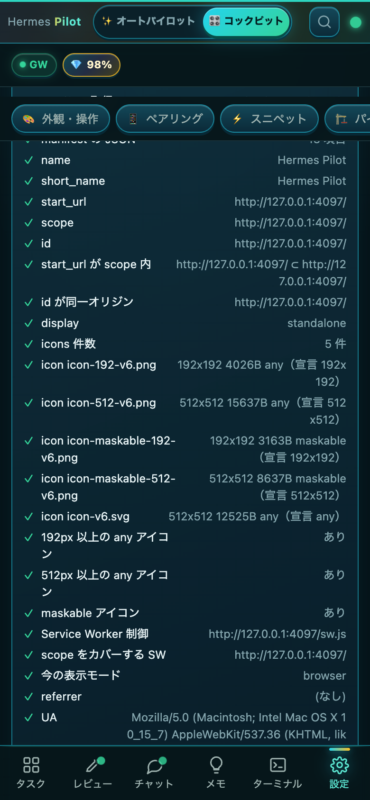
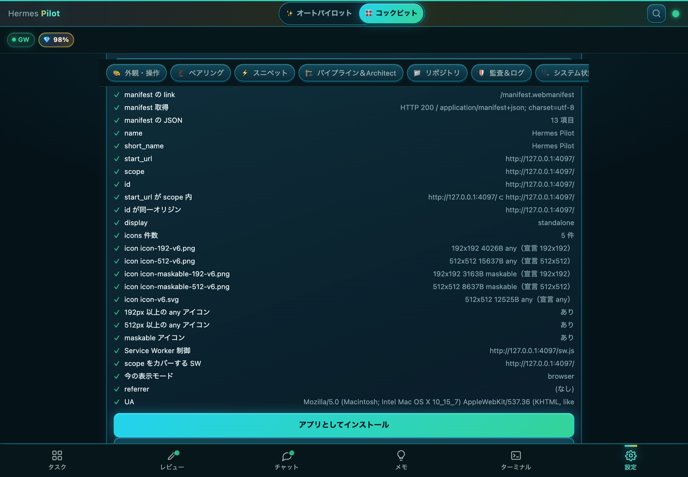
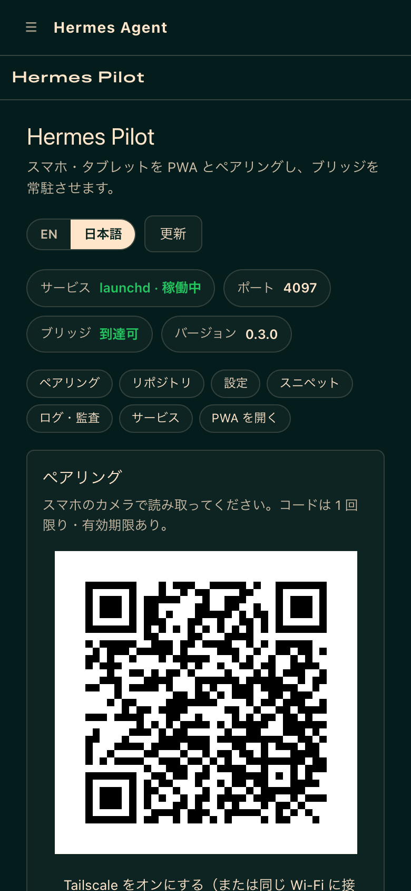
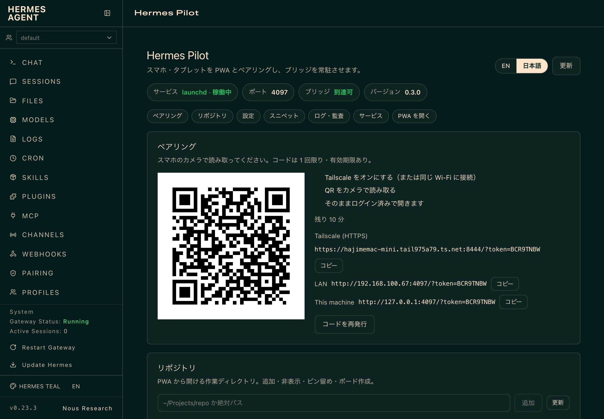

# Manual: 導入と設定（インストール・ペアリング・PWA 診断・ダッシュボード連携）

このページは Hermes Pilot を **初めて入れる人** のための 1 本目です。
インストール → 常駐化 → 端末のペアリング → Settings の読み方 → ホーム画面インストール（PWA 診断）→ 標準ダッシュボードとの連携、までを順に進めます。

> スマホ縦 `390×844` とタブレット横 `1180×820` のスクリーンショットを並べています。同じ画面が、片手操作では 1 列に、タブレットでは 2 ペインに組み替わります。

## 1. インストール（3 ルート）

**前提**: Node.js **22.19 以上**、そして Hermes Agent が動いていること（ブリッジは `http://127.0.0.1:9119` を中継します）。

### A. npm から（最短・clone 不要）

```bash
npx hermes-pilot@0.3.0 init      # データ・トークン・同梱スキル・ペアリング QR（冪等）
npx hermes-pilot@0.3.0 start     # ブリッジ起動（http://127.0.0.1:4097）
```

ログインをまたいで常駐させるなら、一度だけ入れて `service` を使います。

```bash
npm i -g hermes-pilot@0.3.0
hermes-pilot service install     # macOS は launchd、Linux は systemd --user
```

### B. Hermes のプラグインカタログから

```bash
hermes plugins install hermes-pilot      # カタログ登録名。レビュー済みの pin がそのまま使われる
cd ~/.hermes/plugins/hermes-pilot
npm ci
node bin/hermes-pilot.mjs init
```

GitHub から直接入れる場合、`--ref` は **40 桁の commit SHA** を渡してください（`--ref v0.3.0` のようなタグ指定は拒否されます）。

### C. このリポジトリを clone して

```bash
git clone https://github.com/hajimemanila/hermes-pilot.git
cd hermes-pilot
npm ci
node bin/hermes-pilot.mjs init
```

**B / C では `npm ci` を省略できません。** ブリッジは `ws` とネイティブアドオンの `node-pty` を使い、`postinstall` が `spawn-helper` の実行ビットを戻しています（無いとターミナルタブが `posix_spawnp failed` で落ちます）。

### `init` が行う 5 つのこと（何度実行しても安全）

1. `~/.hermes/plugin-data/hermes-pilot/`（と `review/{sheets,shots,library}`）を作成
2. **256-bit hex のアプリトークン**を `token` に `0600` で生成（既にあれば作り直さない）
3. 旧バージョンのデータディレクトリが残っている場合のみ、設定を非破壊で移行（コピーのみ・更新時刻保持）
4. 同梱スキル `quick-review` / `annotation` / `spec-architect` を `~/.hermes/skills/` と Pilot プロファイルの `profiles/<pilot>/skills/` へ配置
5. 到達可能なアドレス（Tailscale の MagicDNS 名、無ければ LAN IP）を検出して、**ペアリング URL とターミナル QR** を表示

### 常駐化と起動確認

```bash
node bin/hermes-pilot.mjs service install     # macOS は launchd、Linux は systemd --user
node bin/hermes-pilot.mjs service status
node bin/hermes-pilot.mjs service restart
```

ブラウザで `http://127.0.0.1:4097/healthz` が応答すれば起動しています。外出先から使うなら Tailscale `serve` を前段に置き、`https://<host>/` で開きます。

## 2. 端末のペアリング（長いトークンを打たない）

| 📱 スマホ縦（`390×844`） | 🖥️ タブレット横 2 ペイン（`1180×820`） |
| :---: | :---: |
|  |  |

- **ターミナルから**: `node bin/hermes-pilot.mjs qr` が候補と QR を表示します。Tailscale `serve` が 443 以外で HTTPS を出している場合は `--tls-port 8444` を付けます。
- **アプリから**: Settings → **端末を追加** → **ペアリング QR を表示**（`GET /api/auth/pairing`）。2 台目のスマホ／タブレットで読み取ります。
- 到達可能なアドレスが見つからないときは「Tailscale に接続するか同じ LAN に入ってから開き直してください」と表示されます。LAN 内なら Tailscale 無しでも `http://<lan-ip>:4097` で入れます。

### QR に載っているもの

QR に載るのは **ワンタイムのペアリングコード**（既定 8 文字・有効 10 分・1 回限り）で、アプリトークンそのものではありません。ブリッジはコードのハッシュだけを `pair-codes.json`（`0600`）に保存し、平文は発行時にしか存在しません。

読み取った端末は `?pair=<code>` を開き、そのコードを **`HttpOnly` / `SameSite=Strict` のセッション Cookie** に交換します。交換後は `history.replaceState` でアドレスバーからトークン／コードを消すので、履歴・ブックマーク・スクリーンショットに残りません。

- **コードが失効した（10 分超過・使用済み）**: QR を表示し直せば新しいコードが出ます。同じコードは二度使えません。
- **全端末をログアウトさせたい**: `rm ~/.hermes/plugin-data/hermes-pilot/token` してブリッジを再起動します。以後は再ペアリングが必要です。
- **書き込み系 API** は `X-Client: mobile` ヘッダとセッション Cookie の両方が必要です（無いと 401）。クロスサイトのフォーム送信では動きません。

> ペアリング QR のスクリーンショットはパスワードと同じ扱いにしてください。

## 3. Settings の全体像

| 📱 スマホ縦（`390×844`） | 🖥️ タブレット横 2 ペイン（`1180×820`） |
| :---: | :---: |
|  |  |

Settings は「外観・操作 → ペアリング → スニペット → パイプライン＆Architect → リポジトリ → 監査＆ログ → システム状態・診断」の順に並びます。

| セクション | 主な項目 | 使いどころ |
| :--- | :--- | :--- |
| 外観・操作 | 表示言語（自動 / English / 日本語）、テーマ（ダーク / ライト / 端末に合わせる）、Vibe モード（⚡ ドーパミン / 🧘 セロトニン）、タップ時の振動、効果音、表示する帯 | 端末ごとに見た目を決める。振動と効果音は Vibe とは独立に維持される |
| ペアリング | **端末を追加**（ペアリング QR） | 2 台目以降のログイン |
| スニペット | チャットと端末の定型チップ（Hot / 非表示の切替、追加・編集・並べ替え・削除、「既定に戻す」） | よく使う指示を 1 タップ化する |
| パイプライン＆Architect | **SOUL.md とスキルを今すぐ最適化**（`POST /api/pipeline/optimize`） | 抽象ロールの割当をプロファイルへ冪等に書き込む |
| システム状態・診断 | モデル、メモリ、ディスク、稼働状態、ブリッジのポート、判断待ち件数、最終確認、起動元（スタンドアロン / ブラウザ）、インストール可否、**PWA 診断を実行**、**アプリとしてインストール** | 「今どこで動いているか」とインストール可否を 1 画面で確認する |
| リポジトリ | 自動スキャン先（直下 1 階層）、追加・ピン・非表示・再スキャン、直近のセッション | ボードと SPEC の探索範囲を決める |
| 監査＆ログ | `~/.hermes/plugin-data/hermes-pilot/audit.jsonl` の閲覧 | 誰が何を書き込んだかを追う |

### 「Optimise this Hermes」= 1 タップ環境最適化

バッチを振り分けるのはモデル名ではなく **抽象ロール** です。リポジトリと同梱スキルは、この 4 語彙しか使いません。

- `role:planner` — 設計・仕様策定・影響分析・難所の原因究明
- `role:builder` — 実装・テスト修復・ビルド・定型のカンバン作業（既定）
- `role:visual-reviewer` — スクショ／赤入れ画像の読解と `390×844` / `820×1180` の視覚検収
- `role:decision-framer` — クイックレビューの設問設計とトレードオフ整理

SPEC のバッチに `- **Recommended Role**: role:planner` と書けば、ブリッジがそれを抽出して起票タスクの実行契約にロール指針を注入します。書かない SPEC は従来どおりに動きます。

**SOUL.md とスキルを今すぐ最適化** を押すと、マーカーブロックが Pilot 用プロファイル `~/.hermes/profiles/<pilot>/SOUL.md`（既定 `mobile`）へ冪等に書き込まれます（実行前に `.bak-<stamp>` を退避。ルートの `~/.hermes/SOUL.md` と他のプロファイルはマーカーが既にある SOUL だけを同期し、`pilotProfile = default` の場合のみルートへ追記します。また同梱 3 スキルも `~/.hermes/skills/` と `profiles/<pilot>/skills/` の両方に配置されます）。状態 API はファイルの中身ではなく、プロファイルごとの適用状況だけを返します。

委譲はネイティブ（Hermes 自身の委譲機構）だけで、外部 AI CLI の子プロセスは起動しません。しかも **止まりません**: 委譲先がエラー・レート制限・タイムアウト・未設定のいずれでも、親はプロファイルが宣言したフォールバック順で自分のモデルのまま続行し、バッチは最後まで完走します。

## 4. ホーム画面インストールと PWA 診断

| 📱 スマホ縦（`390×844`） | 🖥️ タブレット横 2 ペイン（`1180×820`） |
| :---: | :---: |
|  |  |

Settings → **PWA 診断を実行** を押すと、その場で manifest とアイコンと Service Worker を検査します。読み取り専用の検査なので、何度押しても状態は変わりません。

| 診断行 | 緑になる条件 | 赤いときの直し方 |
| :--- | :--- | :--- |
| manifest の link | `<link rel="manifest">` がある | アプリの殻（`/`）を開き直す。プロキシが HTML を書き換えていないか確認 |
| manifest 取得 / manifest の JSON | `/manifest.webmanifest` が認証なしで 200 を返し、JSON として読める | 公開パスを絞りすぎていないか（`/manifest.webmanifest` は認証不要が正） |
| start_url が scope 内 | `start_url` が `scope` の内側 | リバースプロキシのパス接頭辞と `scope` を揃える |
| id が同一オリジン | `id`（未指定なら `start_url`）が同じオリジン | 別ホスト名で開いていないか（MagicDNS 名と LAN IP の混在） |
| 192px 以上の any アイコン / 512px 以上の any アイコン | それぞれ 1 枚以上 | 無いと **インストール不可**。アイコンファイル（`icon-192-v6.png` / `icon-512-v6.png`）が配信されているか確認 |
| maskable アイコン | `purpose: maskable` が 1 枚以上 | 無いとホーム画面で白い枠が出る |
| Service Worker 制御 | 今のページが SW の制御下にあり、`scope` をカバーしている | 一度ハードリロード。`/sw.js` が配信されているか確認 |
| 今の表示モード | `standalone` | ブラウザ表示のままなら、インストール後にホーム画面から起動する |

**アプリとしてインストール** は Chrome の WebAPK 生成を使います。生成時は資格情報なしで manifest / アイコンを取りに来るため、ブリッジはアプリの殻（`/`, `/assets/*`, `/manifest.webmanifest`, `/sw.js`, `/icon-*`, `/auth`, `/healthz`）だけを公開し、`/api/*` と `/ws/*` はすべて認証の内側に置いています。診断が「不可（要件未達）」のときは、上の表の赤い行がそのまま理由です。

> ホーム画面から起動したアプリ（スタンドアロン）では、アドレスバーが消える代わりに「戻る」が OS のジェスチャになります。Settings の **起動元** が `スタンドアロン` なら正しくインストールされています。

## 5. 標準 Hermes Dashboard（`:9119`）との一元連携

| 📱 スマホ縦（`390×844`） | 🖥️ タブレット横 2 ペイン（`1180×820`） |
| :---: | :---: |
|  |  |

標準ダッシュボードの **Hermes Pilot** タブは、PWA と **同じファイル** を操作します。片方で変えたものがもう片方にそのまま出ます（同期先は 1 か所だけ）。

| できること | 中身 |
| :--- | :--- |
| リポジトリ管理 | 追加・ピン・非表示・ボード作成。`scanDirs` の設定箇所は 1 か所だけ |
| スニペット | チャットと端末の定型チップを、英語・日本語のまま追加・編集・並べ替え・削除（「既定に戻す」つき） |
| ログ | ブリッジ／ゲートウェイ／監査ログを閲覧。監査ログは全書き込みが `~/.hermes/plugin-data/hermes-pilot/audit.jsonl` に追記されたもの |
| 状態 | 判断待ち件数・稼働中タスク・ブリッジの稼働状況 |

Pilot を更新したあとは、ダッシュボード側のプラグインファイルを入れ替えてください。

```bash
node bin/hermes-pilot.mjs init --force      # 更新後にダッシュボードのプラグインファイルを入れ替える
```

## 6. よくある詰まり

| 症状 | 原因と直し方 |
| :--- | :--- |
| `hermes-pilot start` で `EADDRINUSE`（4097） | 旧サービスが 4097 を掴んでいます。`node bin/hermes-pilot.mjs start --port 4098` で先に確認し、旧ラベルを `launchctl bootout` してから入れ替えます |
| ログイン画面で「アプリトークンを入力してください」から進まない | トークンは `~/.hermes/plugin-data/hermes-pilot/token`（`0600`）。QR で入るのが正規ルートです。手入力は最後の手段 |
| 401 が返る | 書き込み系は `X-Client: mobile` ヘッダが必須。curl で叩くときは `?t=$(cat ~/.hermes/plugin-data/hermes-pilot/token)` と併用します |
| ターミナルタブが `posix_spawnp failed` | `npm ci` を省いた可能性。`npm ci` で `postinstall` を走らせ、`spawn-helper` の実行ビットを戻します |
| ペアリング QR が読めない／切れる | コードは 10 分で失効し 1 回限りです。表示し直して新しい QR を読み取ります（トークンの手入力に逃げない） |
| 診断は緑なのにインストールできない | ホスト名が変わっていないか確認（`id` の同一オリジン行）。MagicDNS 名と LAN IP を混ぜると WebAPK 生成が失敗します |

---

次は目的のスタイルに合わせて進めます：

- 手軽にスワイプ主体で進めたい場合 → [ショーケース②: オートパイロット編](Showcase-Autopilot-Mode.md)
- カンバン・仕様書・詳細 diff までじっくり操作したい場合 → [Manual: A2B タスクとレビュー](Manual-A2B-Tasks-and-Review.md)
