# ショーケース② — オートパイロット編（FocusFlow をスワイプだけで作る）

[← Home](Home.md) ｜ [ショーケース①: コックピット編](Showcase-From-Idea-to-Product.md) ｜ [導入・設定編](Manual-Installation-and-Setup.md) ｜ [Tasks & Review 編](Manual-A2B-Tasks-and-Review.md) ｜ [Chat・Memos・Terminal 編](Manual-Chat-Memos-and-Terminal.md)

**コードやタスク管理の画面をほとんど開かず、「選ぶ・スワイプする・眺める・割り込む」だけで 1 本のアプリを仕上げる体験です。**

このページは Hermes Pilot `v0.3.0` で追加された **オートパイロットモード** を使い、ショーケース①と同じ題材 **FocusFlow（ミニマル・ポモドーロ＆タスクタイマー）** をスマホ片手で完成させる流れを紹介します。

- 各シーンは **左: 📱 スマホ縦（`390×844`）/ 右: 🖥️ タブレット横（`1180×820`）** の 2 枚並列で掲載しています。
- 画面上部の **`✨ Autopilot ⇄ 🎛 Cockpit`** トグルはいつでも 1 タップで切り替えられます（裏で動いているときはコックピット側にも青い稼働ドットが点灯します）。

> オートパイロットで気軽に始めて、途中の細かいログや Git Diff・複数バッチの調整をしたくなったらコックピットへ切り替える、といった行き来もシームレスです。

---

## 全体の流れ（4 幕スタジオ）

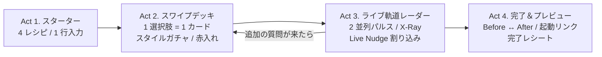

---

## Act 1 — スターター: 1 行入力またはレシピから始める (`AP01`)

| 📱 スマホ縦 `390×844` | 🖥️ タブレット横 `1180×820` |
| :--- | :--- |
| 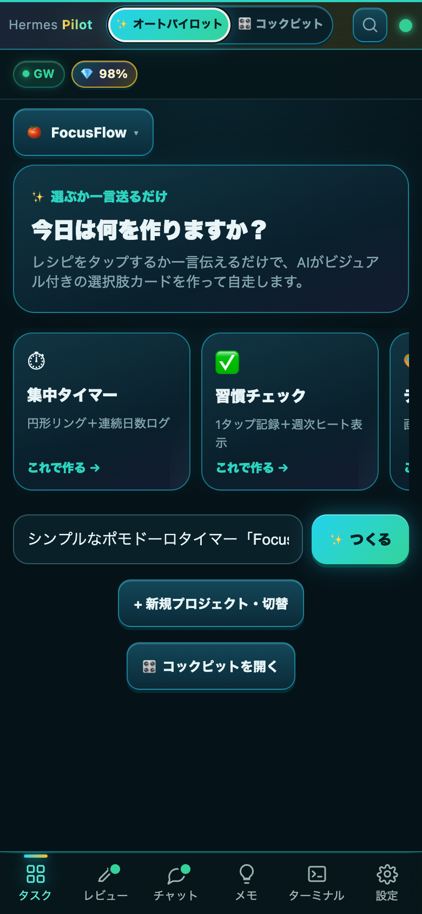 | 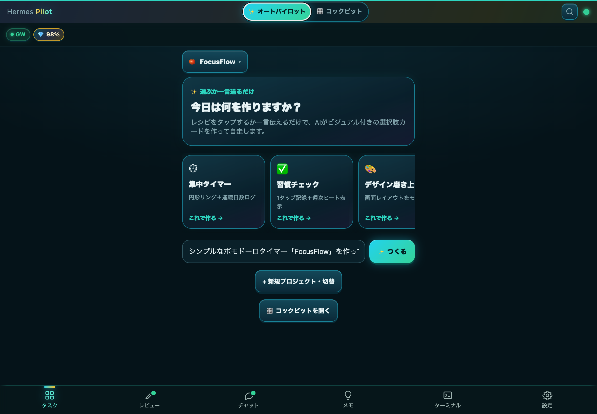 |

### 画面の読み方

- **上部プロジェクトバー**: いま作業中のプロジェクト／ボード（例: `🍅 FocusFlow`）をタップ 1 つで切り替えたり、`+ 新規プロジェクト・切替` から作成したりできます。すでに静的ビルドがある場合は右側に **`🌐 完成品を見る ↗`** チップが出ます。
- **4 つのレシピカード**: 迷ったときは用途別カード（`これを作る →`）をタップするだけで、そのまま構築が始まります。
- **1 行ランチャー**: 自分の言葉で「何を作りたいか」を入れて **`✨ つくる`** を押すだけ。複雑な設定は不要です。

### 入力例（そのまま試せます）

```text
シンプルなポモドーロタイマー「FocusFlow」を作って
```

送信すると、裏側で仕様の論点を 3 問前後の視覚カードに整理し、自動で Act 2 へ切り替わります。

---

## Act 2 — スワイプデッキ: 1 選択肢 = 1 カードで直感決定 (`AP02`)

| 📱 スマホ縦 `390×844` | 🖥️ タブレット横 `1180×820` |
| :--- | :--- |
| 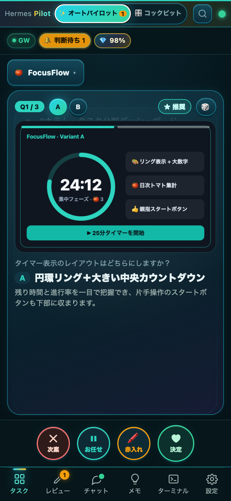 | 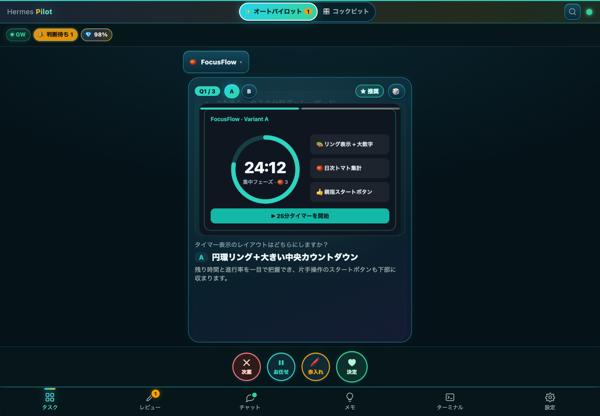 |

### 画面の読み方

- **1 選択肢 = 1 カード（Option-Cycle）**: ラジオボタンを並べる代わりに、A 案・B 案…の完成イメージ（ビジュアルモック）と説明が 1 枚のカードとして順番に現れます。
- **直感スワイプ & 下部 4 ボタン**:
  - **右スワイプ（`♥ 決定`）**: 表示中の案を採用し、次の質問へ進みます。
  - **左スワイプ（`✕ 次案`）**: B 案・C 案へ切り替えます（最後の選択肢で左スワイプするとリミックス帯が開きます）。
  - **上スワイプ（`🖍 赤入れ`）**: その場のモック画像にペンや矩形で直接修正を描き込んでから採用できます。
  - **下スワイプ（`⏸ お任せ`）**: AI にお任せ／メモとして後回しにします（直後の `Undo` ピルで 3 秒間取り消せます）。
- **ストーリーバー＆長押し比較（Peek）**: カード上部バーの左右タップで A ⇄ B を 0.1 秒で切り替え、長押ししている間だけ次案をチラ見できます。

> ドーパミンモードが ON の場合、スワイプ確定のしきい値（90px）を越えた瞬間に手元の軽い触覚フィードバックと火花エフェクトが出ます。

---

## Act 2 応用 — スタイルガチャ＆リミックスで方向転換 (`AP03`)

| 📱 スマホ縦 `390×844` | 🖥️ タブレット横 `1180×820` |
| :--- | :--- |
| 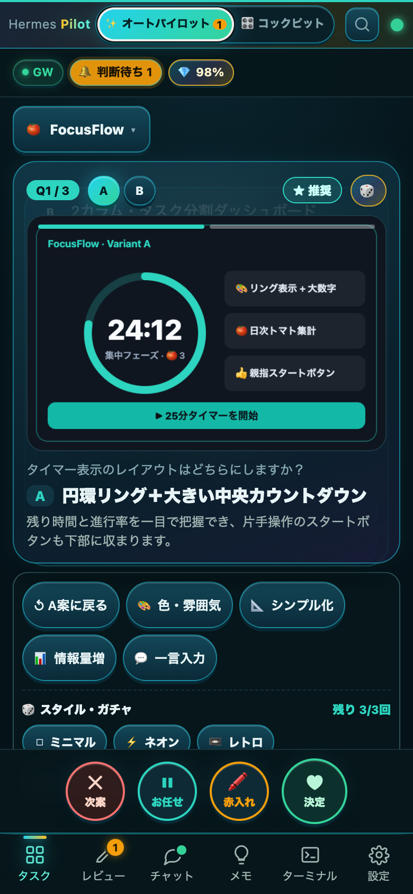 | 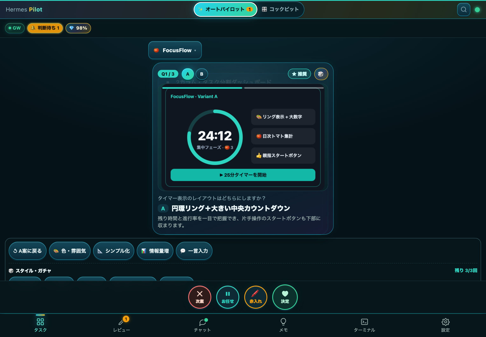 |

### 画面の読み方

- カード右上の **`🎲`**（または最終案で左スワイプ）を押すと、**リミックス＆スタイルガチャ帯**が展開します。
- **`↺ 最初の案に戻る`** や **`もっとシンプルに` / `別案を作る` / `一言メモ`** に加え、スタイルガチャで「ミニマル」「ネオン」「リッチカード」など別の雰囲気へ 1 タップで振り直しを依頼できます（1 カード最大 3 回まで）。

インタビューカードをすべて答え終わると、待たされることなく即座に Act 3（ライブ制作スタジオ）へ移行します。

---

## Act 3 — ライブ制作スタジオ & 軌道レーダー (`AP04`)

| 📱 スマホ縦 `390×844` | 🖥️ タブレット横 `1180×820` |
| :--- | :--- |
| 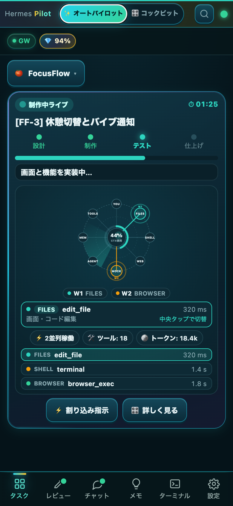 | 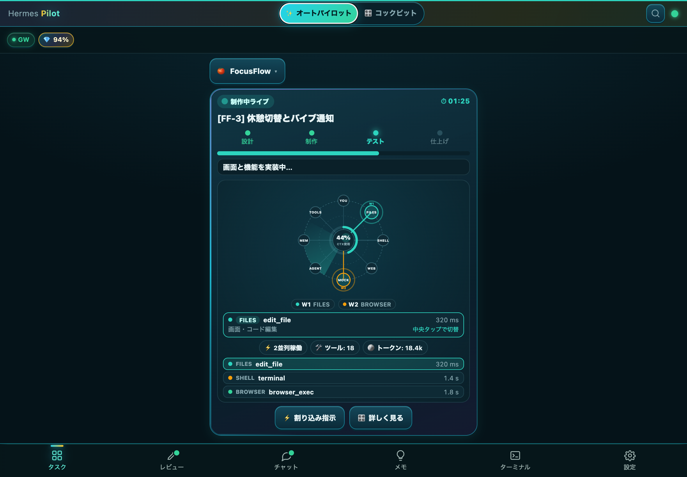 |

### 画面の読み方

実装が始まると、進行中の作業が **4 段階進捗バー（設計 → 制作 → テスト → 仕上げ）** と **Panoptes 軌道レーダー** としてリアルタイムに表示されます。

- **中央のアイリス（瞳）**: いま動いているツール象限の方向へ瞳が向き、外周リングが **コンテキスト使用率**（タップすると **キャッシュヒット率 ⇄ コスト**）を示します。
- **2 並列ワーカー視覚分離**: 複数のワーカーが同時に走っているときは、**`W1`（ティール）／`W2`（アンバー）** の色分けされたパルスが別々のステーションへ同時に飛び、上部チップでも稼働分担を一目で追えます。
- **下部メトリクス＆ライブフィード**: 稼働ワーカー数・ツール実行回数・この実行の消費トークン・直近の操作フィードが並び、待っている間も進捗を安心して眺められます。

---

## Act 3 応用 — X-Ray プレビュー・Live Nudge・ステップ振り返り (`AP05`)

| 📱 スマホ縦 `390×844` | 🖥️ タブレット横 `1180×820` |
| :--- | :--- |
| 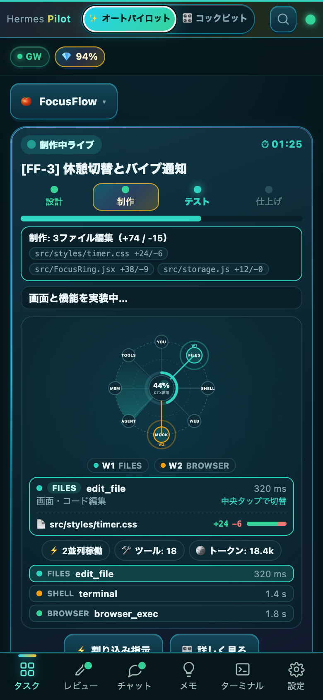 | 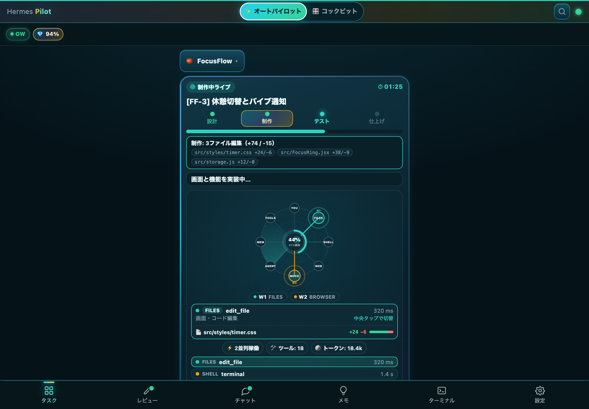 |

### 待機中を「操縦する時間」に変える 3 つの操作

1. **ドットタップで X-Ray プレビュー**:
   - **`FILES`**: いま変更中のファイル名と差分バー（`+24 / -6`）をインライン展開
   - **`SHELL`**: 実行コマンドの意図を 1 行要約し、`✓ 成功 / ✕ 失敗` バッジ付きで表示
   - **`MOCK`（検証）**: 直近に撮影された途中スクリーンショットのミニプレビューを表示
   - **`YOU`**: あなたの割り込みメモや確認待ち項目へ直接ジャンプ
2. **完了済みステップの振り返りタップ**:
   - 進捗バーで完了した **`設計`** や **`制作`** をタップすると、決めた要件の要旨や変更ファイル数・増減行数のサマリをその場で確認できます。
3. **⚡ 割り込み指示（Live Nudge — 待機中の予約指示）**:
   - 下部の **`⚡ 割り込み指示`** から「休憩終了 3 秒前に控えめバイブも入れて」のように送ると、稼働中のバッチを強制中断（手戻り）させることなく `YOU` 象限に **アンバーの予約ピン** が刺さり、次の区切りで自動的にワーカーへ取り込まれます（必要に応じて **`🎛 詳しく見る`** からコックピットの作業詳細へも移動できます）。

---

## Act 4 — 完成＆成果物ランチカード (`AP06`)

| 📱 スマホ縦 `390×844` | 🖥️ タブレット横 `1180×820` |
| :--- | :--- |
| 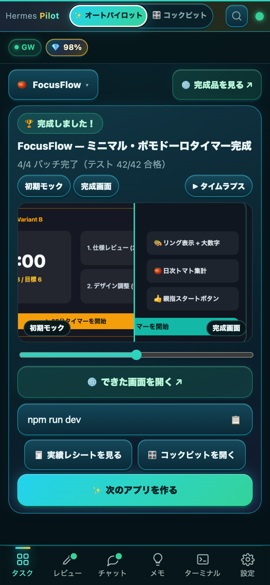 | 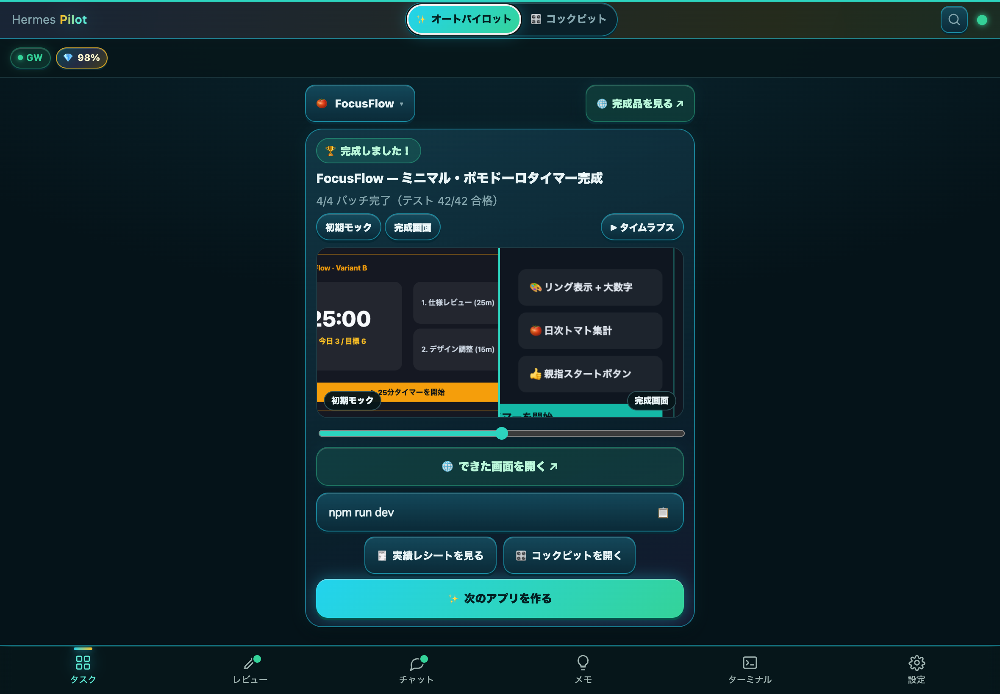 |

### 画面の読み方

すべての実装と検証が終わると、成果物を受け取る **完了カード** が現れます。

- **初期モック / 完成画面 タイムラプス**: スクリーンショット付きの案件では、`初期モック`・`完成画面` の比較スライダーや **`▶ タイムラプス`** で変化を視覚的に確認できます。
- **1 タップ確認＆起動**: **`🌐 できた画面を開く ↗`** でそのまま動かしたり、ローカル起動コマンド（例: `npm run dev`）を 1 タップでコピーできます。
- **実績レシート＆次の周回**: **`🧾 実績レシートを見る`** で `1200×630` PNG とシェア文を取り出せ、**`✨ 次のアプリを作る`** で次の機能追加・新アイデアへ進めます。

---

## 次に読む

- [ショーケース①: コックピット編](Showcase-From-Idea-to-Product.md) — Spec Launchpad・WorkerFeed・赤入れ・Coherence 監査までフル操作する流れ
- [Tasks & Review 編](Manual-A2B-Tasks-and-Review.md) — カンバン詳細・Git Diff・緊急停止・Review インボックスのリファレンス
- [Chat・Memos・Terminal 編](Manual-Chat-Memos-and-Terminal.md) — チャット・メモからの種出し・Theme × Vibe（ドーパミン演出）
- [Home に戻る](Home.md)
