# ショーケース① — コックピット編（FocusFlow 一気通貫）

[← Home](Home.md) ｜ [ショーケース②: オートパイロット編](Showcase-Autopilot-Mode.md) ｜ [導入・設定編](Manual-Installation-and-Setup.md) ｜ [Tasks & Review 編](Manual-A2B-Tasks-and-Review.md) ｜ [Chat・Memos・Terminal 編](Manual-Chat-Memos-and-Terminal.md)

**1 行の思いつきが、動くプロトタイプになり、赤入れで直り、機能が増え、品質が保たれるまで。**
このページは Hermes Pilot `v0.3.0` の **コックピットモード（6 タブ管理）** で A2B パイプライン（仕様策定 → 実装ワーカー → 視覚検収）を、題材 **FocusFlow（ミニマル・ポモドーロ＆タスクタイマー）** で最初から最後まで通す流れを紹介します。

> オートパイロットのカードスワイプ＆軌道レーダー主体で同じ題材を進めたい場合は、[ショーケース②: オートパイロット編](Showcase-Autopilot-Mode.md) をご覧ください。

- 各ステップは **左: 📱 スマホ縦（`390×844`）/ 右: 🖥️ タブレット横 2 ペイン（`1180×820`）** の 2 枚並列で掲載しています。
- 各ステップの入力例はそのままコピーして手元の環境で試せます。

> 所要時間の目安: Step 1〜2 が 10 分、Step 3〜7 が 30〜60 分（ワーカーの自走待ちを含む）、Step 8〜9 は思いついたときに。

---

## 0. 下ごしらえ

1. **Bridge を起動**し、スマホ／タブレットを `/auth` でペアリング済みにしておく（→ 導入・設定編 `MN01_login-pairing`）。
2. **タスクタブでボードを 1 つ選ぶ**（例: `focusflow` ボード）。
3. 言語設定が **日本語（`ja`）** であることを確認する。以下の画面名・ボタン名は日本語 UI の実表記です。
4. 上部トグルが **🎛 コックピット** 側になっていることを確認します。画面下部は **タスク / レビュー / チャット / メモ / ターミナル / 設定** の 6 タブで構成されます。

タブレット幅（`1180`）では、**左ペインが一覧（タスク／レビュー項目）、右ペインが選択中の詳細**という 2 ペイン構成になります。スマホ幅（`390`）では詳細がボトムシートで重なります。同じ操作で、情報密度だけが変わります。

### 全体の流れ

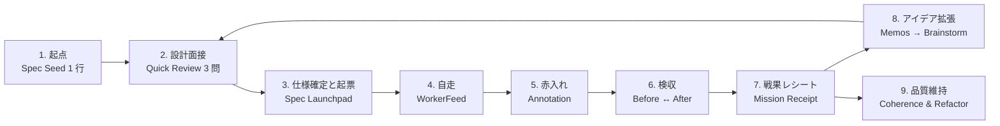

---

## Step 1 — 起点: 1 行のアイデアを Spec Seed に預ける (`SC01`)

| 📱 スマホ縦 `390×844` | 🖥️ タブレット横 `1180×820` |
| :--- | :--- |
| 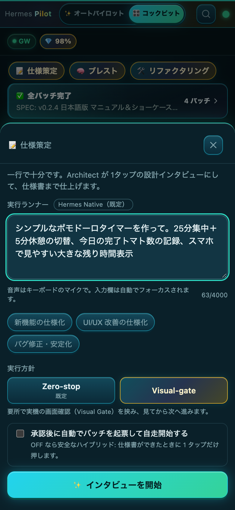 | 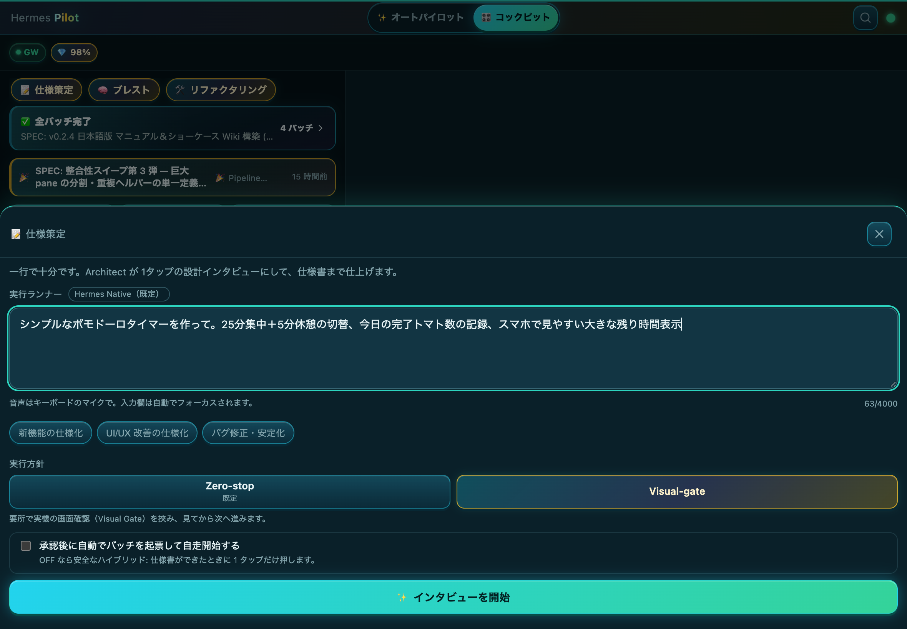 |

### 画面の読み方

タスクタブ下部の **`📝 仕様策定`** チップから「**仕様策定**」シートを開きます。ここが A2B の入り口です。

- **実行ランナー**: `Hermes Native（既定）`。Hermes 本体の推論で仕様を詰める、という意味。
- **本文欄**: 右上に文字数（`63/4000`）。長い仕様書は要りません。**1 行で十分**です。
- **粒度チップ**: `新機能の仕様化` / `UI/UX 改善の仕様化` / `バグ修正・安定化`。選ぶとインタビューの観点が変わります。
- **実行方針**: `Zero-stop`（既定）と `Visual-gate` の 2 択。`Visual-gate` を選ぶと「**要所要所で実機の画面確認（Visual Gate）を挟み、見てから次へ進みます。**」と出ます。見た目を伴う題材はこちら。
- **トグル「承認後に自動でバッチを起票して自走開始する」**: `OFF` のままなら、Step 2 の回答後に自分で起票ボタンを押す。`ON` にすると回答した瞬間に走り出します（慣れるまでは OFF 推奨）。
- 送信は **`✨ インタビューを開始`**。

### コピペ用の入力シード

```text
シンプルなポモドーロタイマーを作って。25分集中＋5分休憩の切替、今日の完了トマト数の記録、
スマホで見やすい大きな残り時間表示
```

粒度は `新機能の仕様化`、実行方針は **`Visual-gate`** を選びます。

### 裏側で起きていること

送信すると **仕様策定ジョブ**（Architect ジョブ）が 1 本立ち、`role:planner` に割り当てたモデルがこの 1 行を読みます。ここでいきなり実装は始まりません。まず **設計上の分かれ道を 3 問（±1）に絞り**、人が決めるべき点だけを Quick Review シートに載せます。タスクの世界観で言えば「仕様書を書く前に、仕様の分岐を潰す」段階です。

> ヒント: 4,000 字を超えると送信できません。エラーが出たら、まず「決めてほしいこと」だけに削ってください。

---

## Step 2 — 設計面接: 3 問に 1 タップで答える (`SC02`)

| 📱 スマホ縦 `390×844` | 🖥️ タブレット横 `1180×820` |
| :--- | :--- |
| 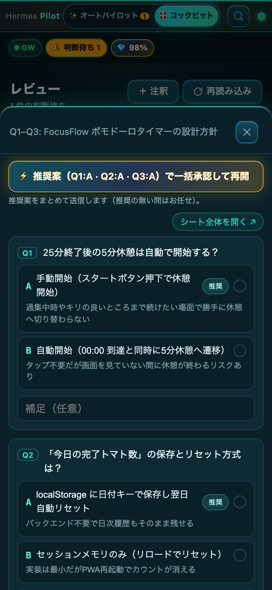 | 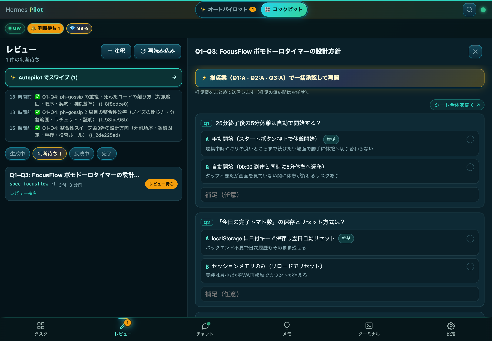 |

### 画面の読み方

レビュータブの「判断待ち」から 1 件を開くと、**「レビュー」シート**が出ます。

- ヘッダに `+ 注釈`（スクショに赤を入れて送る）と `↻ 再読み込み`。
- `シート全体を開く ↗` で、カードに畳まれた本文を全画面で読めます。
- 各問は **3 択**。推奨の選択肢には **`推奨`** チップが付きます。未選択のまま送っても、推奨案で確定します（`未選択は推奨案で確定します`）。
- 上部の **`⚡ 推奨案（要約）で一括承認して再開`** が 1 タップ回答。3 問すべてを推奨で埋めて送信します。
- `▶ レビュー回答（履歴）` を開くと、過去の回答がそのまま残っています。
- 下部の **`✎ スクショに赤入れして追加指示`** は、文章で聞き返す代わりの導線（Step 5 で使います）。`↻ 反応が不十分なとき（再確認を依頼）` は、回答がズレていたときの打ち直し。
- いちばん下の `▶ worker の進行（完了）・30 ステップ` は、Architect がここまで何をしたかのログです。

### コピペ用の入力シード

FocusFlow では、たとえばこんな 3 問が返ります（実際の問いはモデルが 1 行から組み立てます）。

```text
Q1. 25 分終了後の 5 分休憩は自動で開始する？
Q2. 「今日の完了トマト数」は端末内に保存して翌日リセット？
Q3. タイマー終了の通知は、画面内の表示だけで足りる？
```

答えたくない問は未選択のまま、`⚡ 推奨案（…）で一括承認して再開` を押します。

### 裏側で起きていること

回答が届くとタスクは **`ready` に戻り**、Architect が Round 2 で `docs/SPEC-*.md` を書き始めます。ここで「人の決定」と「AI の提案」が分離されているのが肝で、**決定はすべて回答履歴として盤面に残ります**。後から「なぜこの仕様になったか」を回答履歴で辿れます。

---

## Step 3 — 仕様確定と起票: Spec Launchpad から 1 タップ (`SC03`)

| 📱 スマホ縦 `390×844` | 🖥️ タブレット横 `1180×820` |
| :--- | :--- |
| 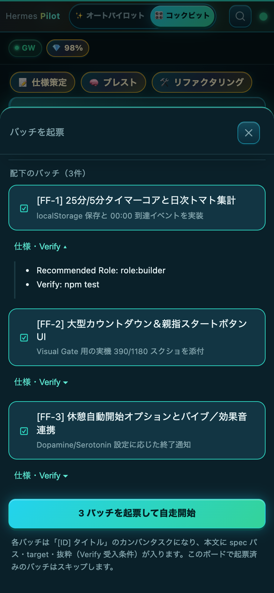 | 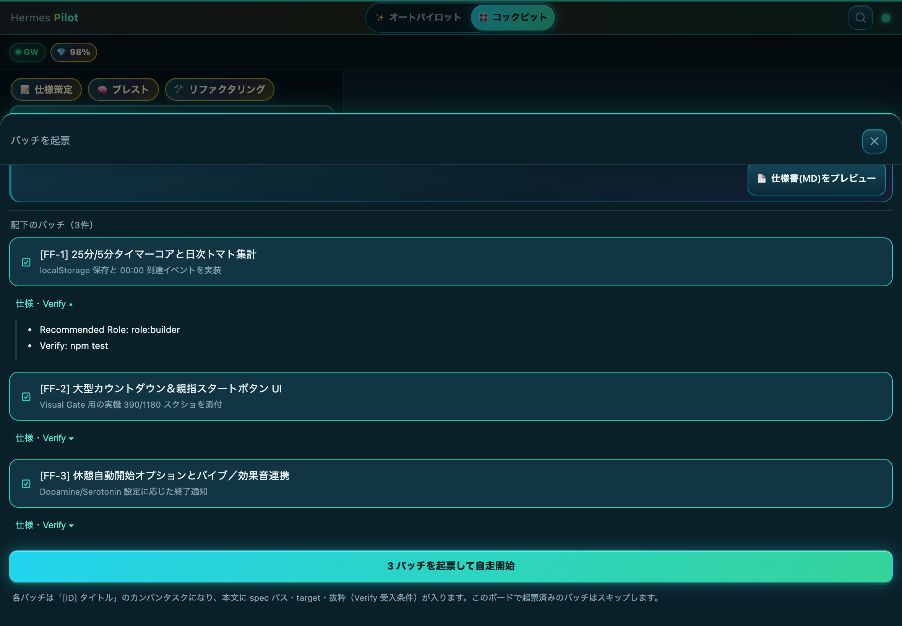 |

### 画面の読み方

タスクタブ上部の **Spec バー**（`バッチを自走実行中…` / `1/4 完了`）をタップすると「**バッチを起票**」シートが開きます。

- 生成された SPEC は **バッチ単位のアコーディオン**で並びます。バッチ名の下に `⚡ 自走完了` / `起票済み` のバッジ、完了していれば `完了済み: t_…` のタスク ID。
- 各バッチを開くと **`仕様・Verify ▾`** に、そのままの見出しで `Execution Mode` / `Recommended Role` / `Objective` / `Files` が並びます。ここを読めば「このバッチは何をどこまでやるか」が起票前に分かります。
- 下部の主ボタンは **`{n} バッチを起票して自走開始`**。**冪等**なので、二度押しても二重起票になりません（既に起票済みのバッチはスキップされ、`{created} 件起票（スキップ {skipped}）` と返ります）。
- チェックボックスで外したバッチは起票されません。**今日はここまで**を自分で決められます。

### コピペ用の入力シード

起票前に仕様を 1 点だけ足したいときは、チャットでこう追記します。

```text
SPEC の Step 3 に「休憩は自動開始せず、スタートを押したときだけ始まる」を
受入条件として明記して。他のバッチはそのままで起票して。
```

### 裏側で起きていること

SPEC の各バッチは **`Execution Mode: [Mode: Zero-Stop]`** と **`Recommended Role: role:builder`** を持ちます。Zero-Stop は「検証コマンドが通るまで自分で直してから完了にする」契約、`role:builder` は「実装は手を動かすレーンに任せる」という割り当てです。起票すると、バッチごとにワーカーが立ち、Step 4 の実況が始まります。

---

## Step 4 — 自走モニタリング: worker の手元を覗く (`SC04`)

| 📱 スマホ縦 `390×844` | 🖥️ タブレット横 `1180×820` |
| :--- | :--- |
| 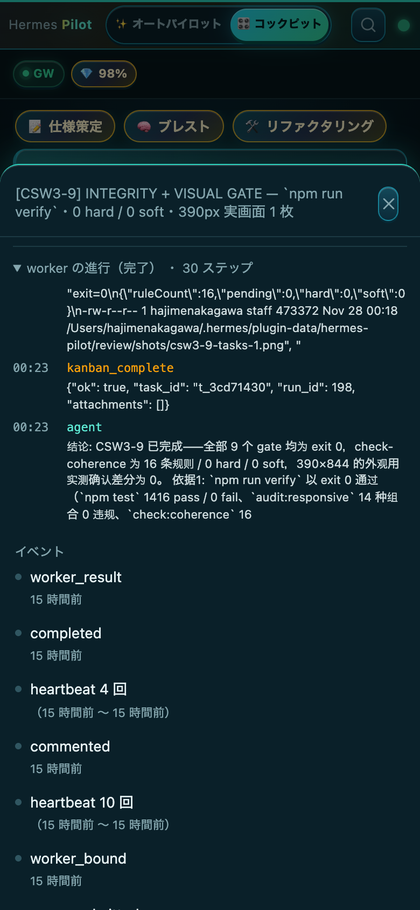 | 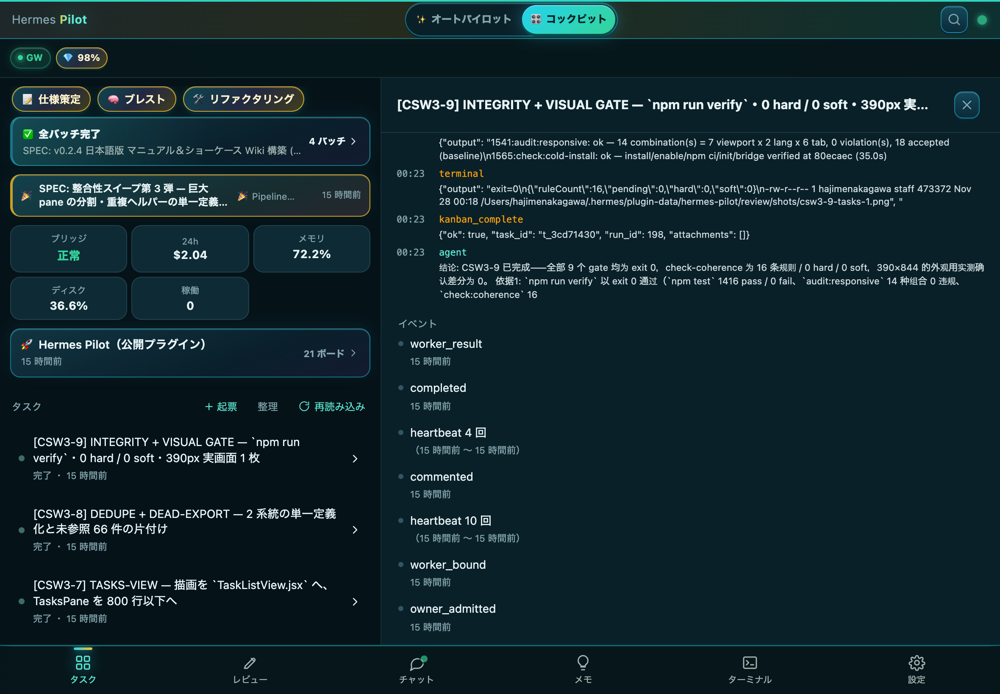 |

### 画面の読み方

タスクタブ上部の **`⚡ バッチを自走実行中…`** バー（`進捗詳細` / `バッチ一覧` 付き）から、実行中タスクの詳細シートを開きます。

- **`▼ worker の進行（生成中）・30 ステップ`**: 時刻付きで、ツール呼び出しが 1 行ずつ流れます。`vision_analyze` でスクショを読んだ、`patch` を当てた、といった実際の手が見えます。
- **`イベント`**: `heartbeat 17 回`（17 分前〜27 秒前）、`worker_bound`、`owner_admitted`、`spawned`、`claimed` …。**heartbeat が増え続けていれば生きている**、という読み方ができます。
- `↻ 再読み込み` は自動。数十秒おきに勝手に伸びます。
- 止めたいときは、この画面のアクション（`claim → block` / abort 系）から。**緊急停止は全タスク一括**の導線も別にあります。

### コピペ用の入力シード

走っている最中に軌道修正したくなったら、タスクにコメントを残します。

```text
いまの実装方針で OK。ただし休憩の秒数は 5:00 固定ではなく、25 分側と同じ
ロジックで短縮できるようにしておいて。完了時に `npm run verify` の結果を添えて。
```

### 裏側で起きていること

ワーカーは**ヘッドレス**で走り、チャットを持ちません。だから進捗はこの WorkerFeed とイベント列がすべてです。完了すると `summary`（何をしたか / 検証コマンドと exit code / 未検証 / 次の一手）が書かれ、それが**チャットと盤面に戻ってきます**。長いターンをチャットで回すより、worker に渡して盤面で見るほうが「動いているか分からない」状態になりません。

---

## Step 5 — 赤入れ: スクショに赤を引いて渡す (`SC05`)

| 📱 スマホ縦 `390×844` | 🖥️ タブレット横 `1180×820` |
| :--- | :--- |
| 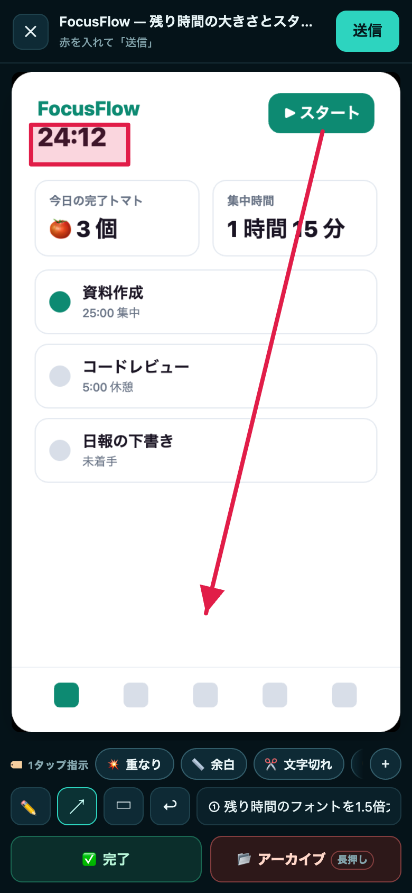 | 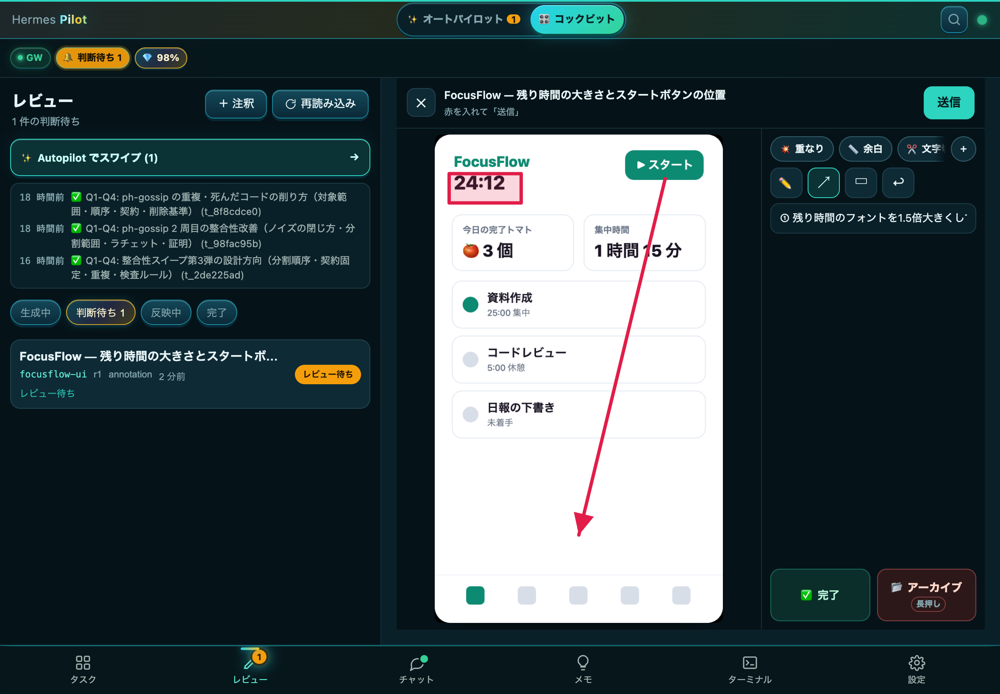 |

### 画面の読み方

`Visual-gate` でワーカーが止まると、レビュータブに**スクショ付きの項目**が届きます。開くと Annotation エディタです。

- 上部にタスク名（例: **`FocusFlow — 残り時間の大きさとスタートボタンの位置`**）と `✕`、右上に **`送信`**。その下に「赤を入れて『送信』」。
- 中央にスクショとキャンバス。**ペン / 矢印 / 矩形 / 戻す** の 4 ツール、色切替、`+` で追加ツール。
- 描いた上に **`ひとこと（任意）`** を添えられます。文字で全部説明しなくてよい代わりに、1 行だけ意図を書く。
- `1 タップ指示` `重なり` `余白` `✂ 文字切れ` のチップは、よくある指摘の定型文。押すとひとこと欄に入ります。
- 下部に **`✅ 完了`** と **`📁 アーカイブ（長押し）`**。赤を入れて送る場合は右上の `送信`。
- タブレット（`1180`）では、**左ペイン = レビュー一覧、右ペイン = エディタ**。赤入れしながら、他の判断待ちも一覧で見えます。

### コピペ用の入力シード（ひとこと欄）

```text
① 残り時間のフォントを1.5倍大きくして中央寄せに / ② スタート・一時停止ボタンを
親指が届く下部エリアに配置
```

### 裏側で起きていること

赤は **画像に対する % 座標**として送られ、`annotation.json`（画像パス・赤の領域・ひとこと）に落ちます。ワーカーはそれを「座標付きの指摘」として読み、修正します。**画像が無く marks だけでも動く**ので、スクショが撮れない場面でも文章より精密に伝えられます。

---

## Step 6 — 比較検収: Before ↔ After を切り替える (`SC06`)

| 📱 スマホ縦 `390×844` | 🖥️ タブレット横 `1180×820` |
| :--- | :--- |
| 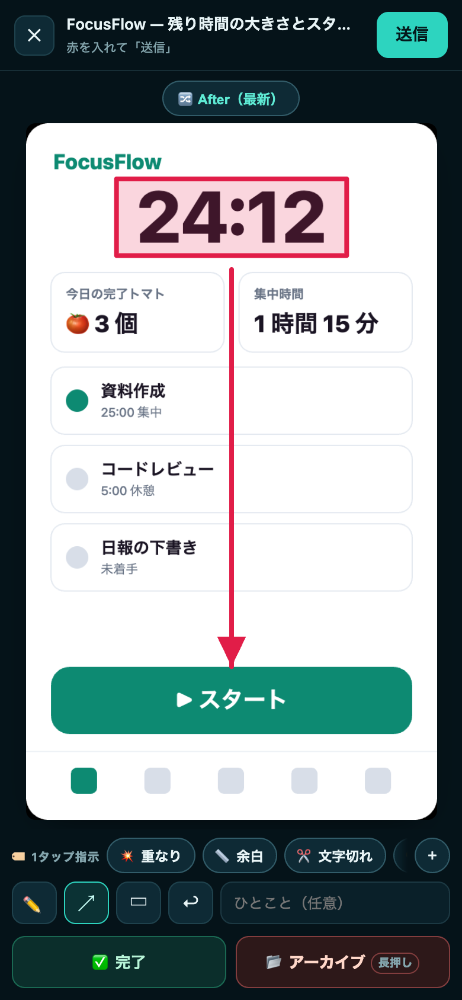 | 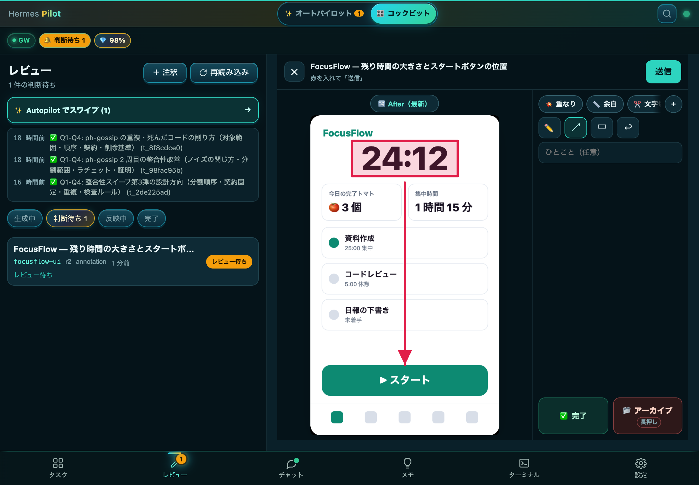 |

### 画面の読み方

修正が返ってくると、同じ項目に**新しいスクショ**が積まれ、上部に比較ピルが出ます。

- **`📷 Before（前回の赤入れ）`** と **`📷 After（最新）`** をタップで行き来。赤入れの線は After 側にも残るので、**赤を引いた場所がどう変わったか**を同じ座標で見比べられます。
- 直っていれば **`✅ 完了`**。不要になった下地を片付けるなら **`📁 アーカイブ（長押し）`**。
- まだ足りないところは、この画面のまま赤を足して `送信`（Step 5 に戻る）。

### コピペ用の入力シード（もう一段だけ赤を足す場合）

```text
フォントとボタン位置は OK。あと 1 点だけ、休憩終了の 3 秒前に控えめに振動させて。
```

### 裏側で起きていること

Before/After は**同じ注釈のまま 2 枚の画像を差し替える**だけなので、指摘の位置がぶれません。合格を押すとタスクは完了し、バッチの進捗（`2/4 完了` など）が上がります。**検収は文章ではなく画像 2 枚の比較**、というのがこの画面の役割です。

---

## Step 7 — 戦果レシート: 何をどれだけ節約したかを 1 枚に (`SC07`)

| 📱 スマホ縦 `390×844` | 🖥️ タブレット横 `1180×820` |
| :--- | :--- |
| 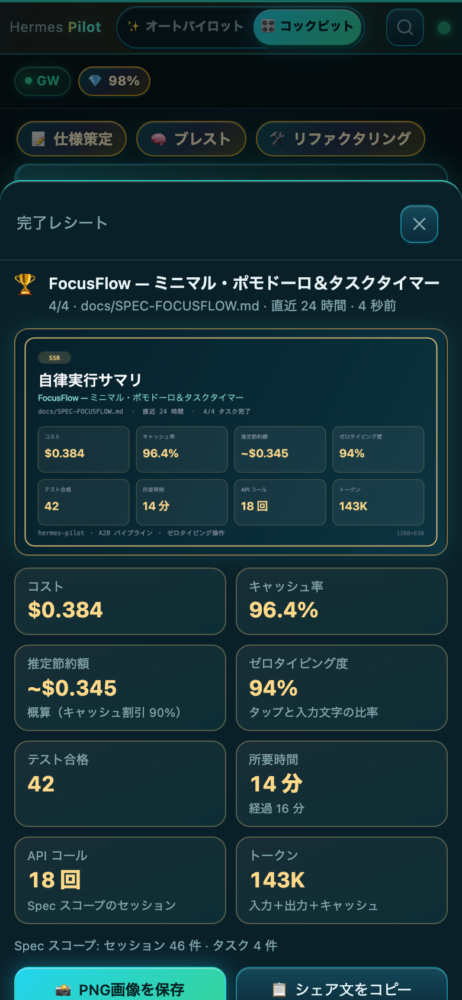 | 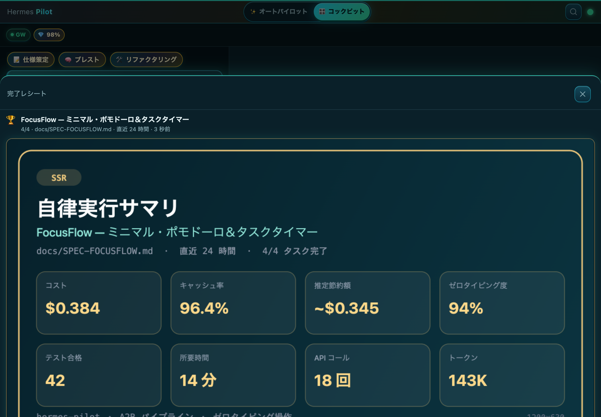 |

### 画面の読み方

全バッチが完了すると、タスクタブのレポートカードに **`🏆 完了レシート`** が出ます。開くと「**完了レシート**」シート。

- ヘッダ: ボード名、`1/4・docs/SPEC-…md・直近 24 時間・4 秒前`。
- 中央に **`1200×630` のカード**（`自律実行サマリ`）。ここがそのまま画像になります。
- KPI タイル: **コスト / キャッシュ率 / 推定節約額 / ゼロタイピング度 / テスト合格 / 所要時間 / API コール / トークン**。推定節約額は「上のコストに既に反映されているキャッシュ割引から逆算した概算」と注記されます。
- 下部: **`📸 PNG画像を保存`** と **`📋 シェア文をコピー`**（X 投稿用・280 文字以内）。`Spec スコープ: セッション N 件・タスク M 件` で、どの範囲の数字かが分かります。

### コピペ用の入力シード（シェア文に足す一文）

```text
FocusFlow（ポモドーロ）を、1 行の種から 4 バッチでここまで。赤入れ 2 往復ぶんの修正込み。
```

### 裏側で起きていること

レシートの数字は、完了した SPEC スコープのセッション・タスクから集計されます。`テスト合格` が `—` になるのは、その実行でテスト件数が見つからなかったという**正直な表示**です（推測で埋めません）。ここが「完了しました」ではなく「何をもって完了としたか」を見せる場所です。

---

## Step 8 — アイデア拡張: メモからブレストへ (`SC08`)

| 📱 スマホ縦 `390×844` | 🖥️ タブレット横 `1180×820` |
| :--- | :--- |
| 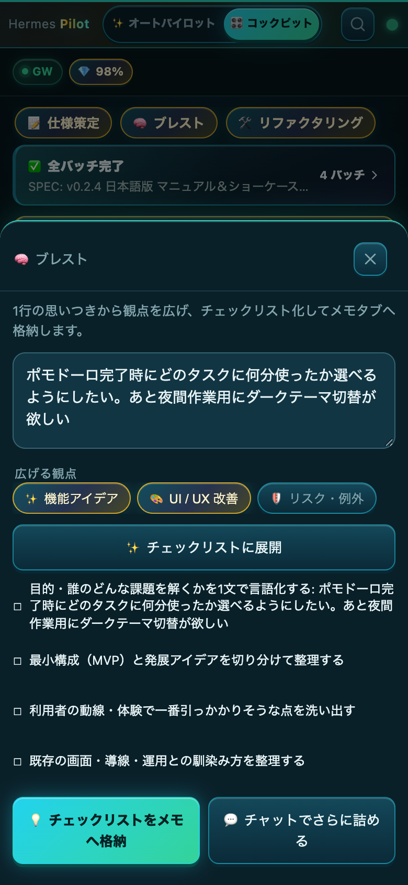 | 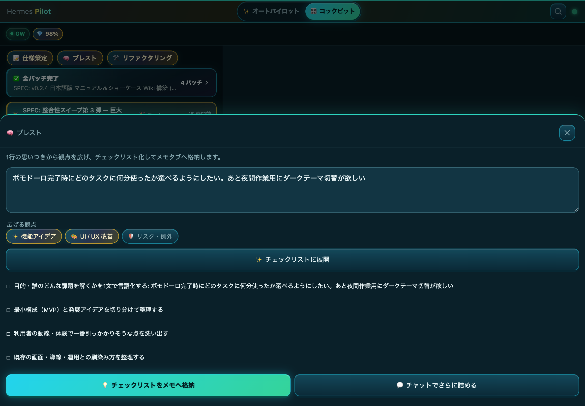 |

### 画面の読み方

完成した直後が、いちばんアイデアが出る時間です。**メモタブ**に気づきを放り込み、カードの **`🧠 ブレスト`** から「**ブレスト**」シートを開きます。

- 上部に「1 行の思いつきから観点を広げ、チェックリスト化してメモタブへ格納します。」
- 本文欄にメモの文面が入った状態で開きます。**そのまま書き換えてよい**。
- **`広げる観点`** チップ: `✨ 機能アイデア` / `🎨 UI/UX 改善` / `⚠ リスク・例外`。
- **`✨ チェックリストに展開`** を押すと、目的・MVP・動線・既存運用との馴染み方の 4 項目に割れます。
- 出口は 2 つ: **`💡 チェックリストをメモへ格納`**（次の周回の材料として残す）と **`💬 チャットでさらに詰める`**。
- メモタブのカードは、スマホでは 1 列、タブレットでは 2 列。**`📝 仕様策定` / `🧠 ブレスト`** へ 1 タップで引き継げます。

### コピペ用の入力シード

```text
ポモドーロ完了時にどのタスクに何分使ったか選べるようにしたい。
あと夜間作業用にダークテーマ切替が欲しい
```

展開後の追加シード（次周回の Spec Seed にそのまま使えます）:

```text
タスク別の集中時間サマリバーとダークモード切替ボタンを追加
```

### 裏側で起きていること

メモは**まだ仕様ではありません**。ブレストで観点を広げ、チェックリストにしてから Spec Seed に戻すことで、Step 1 の 1 行が「思いつき」ではなく「検討済みの 1 行」になります。**Step 2 → 8 → 2** のループが、製品を太らせる主経路です。

---

## Step 9 — 品質維持: 整合性を診て、スイープを 1 本起票 (`SC09`)

| 📱 スマホ縦 `390×844` | 🖥️ タブレット横 `1180×820` |
| :--- | :--- |
| 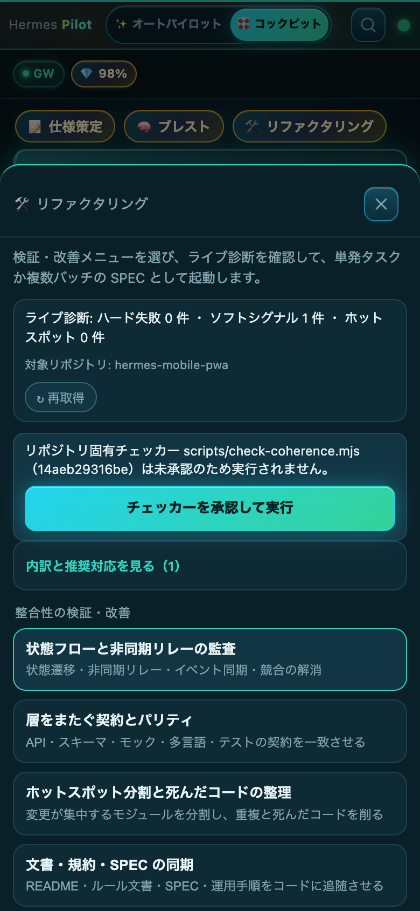 | 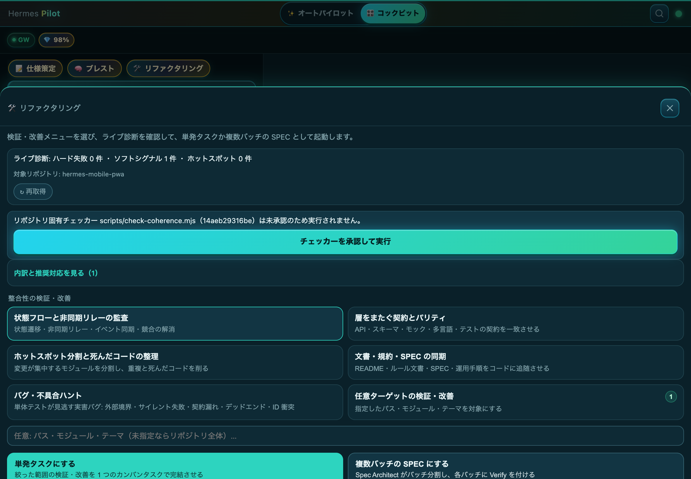 |

### 画面の読み方

タスクタブの **`🛠 リファクタリング`** チップから「**リファクタリング**」シートを開きます。

- 冒頭: 「検証・改善メニューを選び、ライブ診断を確認して、**単発タスクか複数バッチの SPEC として起動**します。」
- **`ライブ診断` 帯**: `ハード失敗 N 件 ・ ソフトシグナル M 件 ・ ホットスポット K 件` を対象リポジトリに対して表示し、`↻ 再取得` で更新できます。
- **`内訳と推奨対応を見る (n)`** を開くと、検出されたシグナルごとに根拠と 1 行の対処方針が並び、`対処する`（対象欄へ自動セット）または `対応しない`（悪化時に自動再浮上するラチェット退避）を選べます。
- メニューは用途別の **全 6 種類** です（各項目の詳しい仕様と判定基準は [Tasks & Review 編 §1-6](Manual-A2B-Tasks-and-Review.md#1-6-リファクタリングシート整合性の検証改善-全-6-項目) を参照）：
  - `状態フローと非同期リレーの監査`（状態遷移・非同期リレー・イベント同期・競合の解消）
  - `層をまたぐ契約とパリティ`（API・スキーマ・モック・多言語・テストの契約を一致させる）
  - `ホットスポット分割と死んだコードの整理`（変更が集中するモジュールを分割し、重複と死んだコードを削る）
  - `文書・規約・SPEC の同期`（README・ルール文書・SPEC・運用手順をコードに追随させる）
  - `バグ・不具合ハント`（単体テストが見逃す 5 大盲点：外部境界・サイレント失敗・兄弟経路の契約漏れ・状態×操作のデッドエンド・ID／キャッシュ衝突。既定は読取専用の調査レポート専念で、チェックボックス ON 時のみ再現テスト確認済みの不具合を修正）
  - `任意ターゲットの検証・改善`（下の入力欄に指定したパス・モジュール・テーマを対象に実行）
- 診断が推すメニューには **`推奨`** バッジが付きます。起動ボタンは **`単発タスクにする`**（1 タスクで完結）と **`複数バッチの SPEC にする`**（Spec Architect がバッチ分割＋Verify 付き SPEC を生成）の 2 択で、どちらも **Zero-Stop** で走ります。

### コピペ用の入力シード（起票時のひとこと）

```text
FocusFlow のタイマー状態遷移と休憩リレーを監査。テストで見逃している
「休憩中のタブ復帰」だけは実害が出ているので、先に潰して。
```

### 裏側で起きていること

診断は内蔵の整合性検査（ハード失敗 / ソフトシグナル / ホットスポット）を API 越しに引いています。数字が 0 のときも正直に 0 件として表示します。起票は単発の整理でも、複数バッチの SPEC でも同じ 1 タップです。

---

## 関連ページ

- **画面の用語・設定**: [導入・設定編](Manual-Installation-and-Setup.md)
- **Tasks / Review の詳しい操作**: [Tasks & Review 編](Manual-A2B-Tasks-and-Review.md)
- **Chat / Memos / Terminal / 外観**: [Chat・Memos・Terminal・外観編](Manual-Chat-Memos-and-Terminal.md)
- **スワイプ＆レーダー版の一気通貫**: [ショーケース②: オートパイロット編](Showcase-Autopilot-Mode.md)
- [Home に戻る](Home.md)
